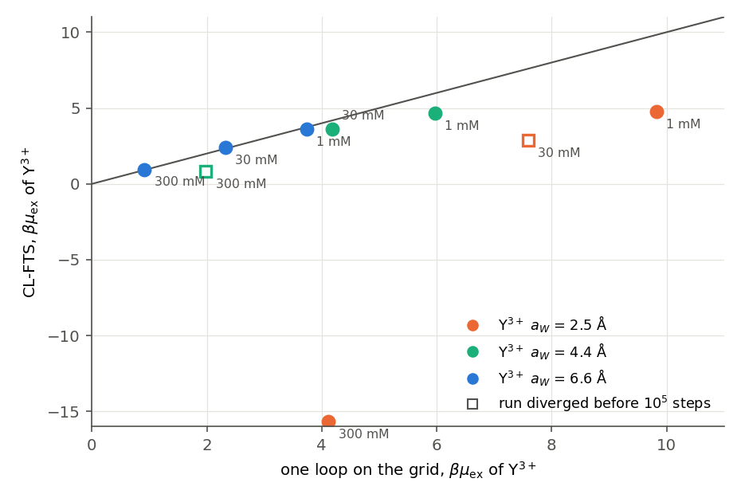

# CL-FTS of the Brush with Multivalent Ions

Complex Langevin simulations (CL-FTS) of the brush of [BrushMultivalentIons.py](../../../examples/charged/ecscft/BrushMultivalentIons.py), a test of its approximations. The validation page of the example, [BrushMultivalentIons.md](../../../docs/validation/BrushMultivalentIons.md#complex-langevin-simulations), holds the results of the brush against EC-SCFT. Section 1 gives the radii of the example; Section 2 gives the runs of the brush, to repeat them.

| File | Content |
|---|---|
| [clfts/bulk_clfts.py](../clfts/bulk_clfts.py) | Bulk CL-FTS of a 3:1 salt, one state per run, $`\mu_{\rm ex}`$ per $`10^4`$ steps against one loop on the same grid |
| [clfts/plot_bulk.py](../clfts/plot_bulk.py) | The figure of Section 1, from the runs in `references/charged_polymers/brush_clfts_bulk/` (outside git) |
| [clfts/brush_clfts.py](../clfts/brush_clfts.py) | 3D CL-FTS of the brush, started from 1D SCFT or from a checkpoint (`--restart`, `--start-from`) |

## 1. Trivalent ions in bulk CL-FTS



CL-FTS of a 3:1 salt of smeared point ions in a periodic box of 10 nm on a 0.5 nm grid (the grid of the brush runs), NO₃⁻ of 2.5 Å, $`\delta t=0.001`$, $`10^5`$ steps. The excess chemical potential is $`-{\rm Re}\ln Q`$ of the ion ([CL-FTS theory, Section 7](../../../docs/theory/ComplexLangevinSimulation.md#7-chemical-potential-and-osmotic-pressure)), averaged over $`10^4`$-step intervals after the first; the error is the standard error of the interval means. The one-loop value is that of the same lattice model. The halves of each run at 6.6 Å differ by at most 0.04 kT.

| Y³⁺ of 6.6 Å (the example) | 1 mM | 30 mM | 0.3 M |
|---|---|---|---|
| CL-FTS | 3.600 ± 0.020 | 2.420 ± 0.007 | 0.953 ± 0.001 |
| One loop on the grid | 3.734 | 2.319 | 0.912 |

The runs are stable and within 0.14 kT of one loop. The remaining differences, 0.04–0.13 kT, exceed the errors and the differences between the halves, as corrections beyond one loop would at this coupling ($`z^2\ell_B/a_W\approx10`$). Smaller Y³⁺ is out of reach: at 4.4 Å and at the 2.5 Å of Duan et al. the runs settle at values far from one loop (4.65 and 4.78 kT at 1 mM against 5.97 and 9.82) or diverge. The example takes Y³⁺ of 6.6 Å, the radius that fits the activity coefficients of Y(NO₃)₃ up to 0.1 mol/kg with point-charge screening and one radius for Y³⁺ and NO₃⁻, and the simulations can reach it; it keeps the 2.5 Å of the paper for Na⁺ and NO₃⁻, and gives the segment charges a Born radius of 1.7725 nm (Gaussians of standard deviation $`b`$).

## 2. The brush

`brush_clfts.py` simulates the brush of the example with discrete chains and `rs`: $`N=100`$ segments of $`b=1`$ nm and $`v=1`$ nm³ grafted at 0.1 nm⁻² next to an absorbing wall at $`z=0`$, one negative charge per segment, a solvent of one segment with $`\chi=0.5`$ and $`\zeta N=100`$, $`\ell_B=0.7`$ nm and the radii of Section 1. Na⁺, Y³⁺ and NO₃⁻ are point ions from a reservoir at an ionic strength of 6 mM; their chemical potentials include the one-loop excess of the reservoir on the grid, so that the bulk holds the reservoir concentrations. The grid is 0.5 nm over a height of 100 nm (reflecting top), $`\bar N=100`$, $`\delta t=0.001`$ with `lm` and dynamic stabilization 0.05; $`\psi`$ takes a larger mobility in the solution above the brush. The height is $`h=2\sum z\,{\rm Re}\,\phi_A/\sum{\rm Re}\,\phi_A`$.

The lateral box is 20 nm (2 $`R_0`$ with $`R_0=b\sqrt N`$) with periodic sides. Each run of the validation page started from the last state of a 10 nm periodic run of $`5\times10^5`$ steps (`--start-from`, tiled with its mirror image), which had started from the state at $`6\times10^5`$ steps ($`4\times10^5`$ at 1 µM) of a 10 nm run with reflecting sides from the 1D SCFT; without `--start-from` the script starts from the 1D SCFT. A run of $`3\times10^5`$ steps takes about 22 hours on one A10 or A40 GPU (0.26 s per step) and less than 1 GB of host memory. The options of the runs of the validation page, here for 100 µM:

```bash
python brush_clfts.py P20_y1e-4.json --valence 3 --dx 0.5 --height 100 --lateral 20 --lateral-bc periodic \
    --dt 0.001 --integrator lm --alpha 0.05 --zeta 100 --nbar 100 \
    --ion-smear 0.141 --cation-smear 0.372 --a-int 1.0 --uniform-relax 0.3 --psi-relax 0 --psi-boost 1000 \
    --far 0.0054,0.0001,0.0057 --psi-scale 3 --boost-from 55 --boost-to 65 --seed 17 \
    --steps 300000 --equilibration 50000 --interval 5 --save-interval 50000 --platform cuda --print-every 200 \
    --start-from <checkpoint of the 10 nm run>
```

`--far` gives Na⁺, Y³⁺ and NO₃⁻ of the reservoir in mol/L. The other concentrations change only these options:

| Y³⁺ | `--far` | `--psi-scale` | `--boost-from`, `--boost-to` (nm) | `--seed` |
|---|---|---|---|---|
| 0 | 0.006,0,0.006 | 10 | 85, 95 | 18 |
| 1 µM | 0.005994,1e-06,0.005997 | 3 | 75, 85 | 19 |
| 10 µM | 0.00594,1e-05,0.00597 | 3 | 65, 75 | 21 |
| 100 µM | 0.0054,0.0001,0.0057 | 3 | 55, 65 | 17 |
| 500 µM | 0.003,0.0005,0.0045 | 3 | 50, 60 | 23, then 123 from step $`1.5\times10^5`$ |

At 500 µM the runs took `--save-interval 25000`. Its continuation with `--restart` at step $`1.5\times10^5`$ was given `--save-interval 50000` and stopped at once, because the interval is part of the checkpoint settings; the run continued with `--start-from` from that checkpoint and seed 123.

A run that diverges is started again with `--start-from` and a new seed, from its start state or a later checkpoint; `--restart` with the same seed replays the same noise into the same divergence. `--restart` continues a run to a larger `--steps` with the same `--save-interval`.
