# Theory check of Duan, Agrawal and Wang (2025)

C. Duan, N. R. Agrawal and R. Wang, "Electrostatic Correlation Augmented Self-Consistent Field Theory and Its Application to Polyelectrolyte Brushes", Phys. Rev. Lett. 134, 048101 (2025). [Main text](../../../references/charged_polymers/Duan_2025_Electrostatic_Correlation_Augmented_SCFT.pdf), [SI](../../../references/charged_polymers/Duan_2025_Electrostatic_Correlation_Augmented_SCFT_SI.pdf).

Eqs. 1–9 are the main text, Eqs. S1–S42 the SI. The representative code is [duan_scft.py](../models/duan_scft.py), restored from tag `v0.10.0`, where it is `models/prl_scft.py`. Only its file name, class name, the first line of the class docstring and two error messages changed. The rest of the reproduction code, including `studies/literature_scft.py`, stays in git at that tag under its old names. Every number comes from [duan_scft_check.py](../duan_scft_check.py) with its inputs in `references/charged_polymers/duan_scft_check_data.json` (outside git), except the electrolyte results, which come from the tag. See [section 12](#12-reproduce). Checked 2026-10-31.

## Contents

- [1. Result](#1-result)
  - [1.1 After the corrections](#11-after-the-corrections)
- [2. Method](#2-method)
- [3. Formal theory: SI Sec. I and Eqs. 1–5](#3-formal-theory-si-sec-i-and-eqs-15)
  - [3.1 S26](#31-s26)
  - [3.2 Eq. 3b used as a potential](#32-eq-3b-used-as-a-potential)
- [4. Scaling theory: SI Sec. III and Eqs. 6–9](#4-scaling-theory-si-sec-iii-and-eqs-69)
  - [4.1 Eq. 7](#41-eq-7)
  - [4.2 S40](#42-s40)
- [5. Where the scaling explanation fails](#5-where-the-scaling-explanation-fails)
  - [5.1 Eq. 7 is used outside its range](#51-eq-7-is-used-outside-its-range)
  - [5.2 The neutral crossing is not where Gamma vanishes](#52-the-neutral-crossing-is-not-where-gamma-vanishes)
  - [5.3 The lowest height is not at the Gamma minimum](#53-the-lowest-height-is-not-at-the-gamma-minimum)
  - [5.4 The upper critical concentration](#54-the-upper-critical-concentration)
  - [5.5 Eq. 6](#55-eq-6)
  - [5.6 Fig. 3 plots formulas, not a brush](#56-fig-3-plots-formulas-not-a-brush)
- [6. The low-salt onset is ion exchange](#6-the-low-salt-onset-is-ion-exchange)
  - [6.1 Mechanism](#61-mechanism)
  - [6.2 Numbers](#62-numbers)
  - [6.3 One box length reproduces Fig. 2](#63-one-box-length-reproduces-fig-2)
  - [6.4 The experiment in Fig. 2](#64-the-experiment-in-fig-2)
  - [6.5 Chain length and the two-layer collapse](#65-chain-length-and-the-two-layer-collapse)
  - [6.6 Closed cell](#66-closed-cell)
  - [6.7 Cross-checks at the experiment's solution](#67-cross-checks-at-the-experiments-solution)
- [7. What the model does](#7-what-the-model-does)
  - [7.1 What holds](#71-what-holds)
  - [7.2 What drives the fall](#72-what-drives-the-fall)
  - [7.3 Surface potential](#73-surface-potential)
- [8. Neglected terms and range of validity](#8-neglected-terms-and-range-of-validity)
- [9. Code](#9-code)
- [10. Open questions](#10-open-questions)
  - [10.1 Missing from the paper](#101-missing-from-the-paper)
  - [10.2 Values found in the group's other work](#102-values-found-in-the-groups-other-work)
  - [10.3 Next steps](#103-next-steps)
- [11. Corrected equations](#11-corrected-equations)
- [12. Reproduce](#12-reproduce)

## 1. Result

The model is sound and its high-salt predictions reproduce. The scaling explanation in the main text does not describe what the model does. The low-salt half of Fig. 2 depends on a box length that the paper does not state, and at that length it is not converged ([6.2](#62-numbers)). One value, $`L\approx6.6`$ µm, reproduces all 24 readings for all three valences ([6.3](#63-one-box-length-reproduces-fig-2)).

| Claim in the paper | Verdict | Section |
|---|---|---|
| Correlations give collapse below the neutral height and re-expansion for $`z_+=2,3`$; mean field gives neither | Confirmed | [7.1](#71-what-holds) |
| High-salt branch and minima of Fig. 2 | Confirmed to 0.018 in $`\log_{10}(h/h_0)`$ by SCFT and 0.011 by the layer model; minima to 0.014 and 0.001 | [7.1](#71-what-holds) |
| Collapse and re-expansion need no reversal of $`\psi_S`$ | Confirmed by $`z_+=2`$ | [7.3](#73-surface-potential) |
| $`\Gamma`$ of Eq. 7 fixes the regimes: $`\rho_b^{**}`$ at $`\Gamma=0`$, lowest height at $`\partial\Gamma/\partial\rho_b=0`$ | Wrong | [5.2](#52-the-neutral-crossing-is-not-where-gamma-vanishes), [5.3](#53-the-lowest-height-is-not-at-the-gamma-minimum) |
| Eq. 6 explains why multivalent ions start the collapse at lower salt | Wrong | [5.5](#55-eq-6) |
| The onset is where correlation matches translational entropy, $`\kappa^3\approx\rho_+`$ | Wrong: the onset is ion exchange, and it depends on the box length | [6](#6-the-low-salt-onset-is-ion-exchange) |
| Agreement "for a wide range of salt concentrations" | Reproduced over the whole range, rms 0.012, but only with one unreported box length; without it, only above about 10 mM | [6.3](#63-one-box-length-reproduces-fig-2) |
| Agreement with the experimental symbols of Fig. 2 | Not at the same solution: the $`{\rm Y}^{3+}`$ data carry 3–6 mM $`{\rm NaNO_3}`$ that the calculation omits, and its $`\rho_b`$ is not the $`{\rm Y}^{3+}`$ in its own box. In the experiment's solution the model collapses near 30 nM and the experiment between 10 and 100 µM. In a closed cell about 1.2 mm deep, the kind of finite pool the experiment used, the model follows all four $`{\rm Y}^{3+}`$ symbols to rms 0.05, with the depth fitted | [6.4](#64-the-experiment-in-fig-2)–[6.7](#67-cross-checks-at-the-experiments-solution) |
| Coupling of correlation and conformation is "fully captured" | Overstated: $`u_P^{\rm ex}`$ is dropped | [8](#8-neglected-terms-and-range-of-validity) |

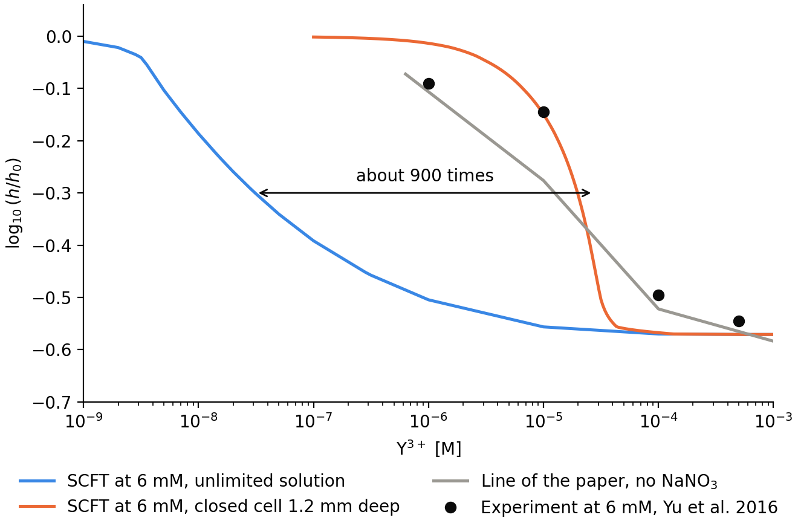

*The main result for the experiment. The grey line of the paper meets the black symbols, but it has no $`{\rm NaNO_3}`$. At the solution of the experiment (blue) the model collapses about 900 times too early. A closed cell (orange) moves it back, with its depth fitted, but that is not the only reading. See [6.4](#64-the-experiment-in-fig-2), [6.6](#66-closed-cell) and [6.7](#67-cross-checks-at-the-experiments-solution).*

The equations contain four real errors: S40 is twice too large, the dilute-limit $`f_{\rm ion}`$ has $`\pi/24`$ for $`1/(24\pi)`$, S26 has a spurious $`G`$, and Eq. 3b gives half the density response when used as a potential. Only S26 could affect the paper's figures, and only if the calculations kept $`I_{ex}`$. Eq. 8 also vanishes in the neutral regime at the paper's own $`\chi=0.5`$. Fig. 3 plots the formulas of Eqs. 7 and 9, with the molar concentration left unconverted in Eq. 9.

The code passes. Its limits are in [section 9](#9-code). The corrected equations are collected in [section 11](#11-corrected-equations).

### 1.1 After the corrections

Fixing the errors restores the equations the paper computes with, but not its scaling explanation.

| Kind | Items | After correction |
|---|---|---|
| Typo or notation | S8, S11, Eq. 3a, Eq. 5, S27a–b, S28, S30, S32, S42, $`\pi/24`$ | Holds |
| Calculation error | S26, S40, S41a, Eq. 8 line 4 | Holds |
| Omission or inconsistency | S27a–b (the derivative of $`\epsilon`$ in the fluctuation terms), S29 to S32 ($`\ln\langle Q_l\rangle`$) | Needs a new term or form. Does not reach the figures: $`\epsilon`$ is uniform, and the second enters only $`u_P^{\rm ex}`$ and $`I_{ex}`$ |
| Structural | Eq. 3b as a potential, S27c | A corrected number is not enough: a chain has no exact one-body potential, see [3.2](#32-eq-3b-used-as-a-potential) |
| Logic | $`\rho_b^{**}`$ at $`\Gamma=0`$, lowest height at the $`\Gamma`$ minimum, Eq. 6, $`\kappa^3\approx\rho_+`$ | Does not hold under any correction to the equations |

- **Formal theory.** With the typos fixed, S1–S25 are a consistent variational calculation. Dropping $`u_P^{\rm ex}`$ and $`I_{ex}`$ together leaves working equations that all come from one free energy.
- **Polymer self-energy.** The paper presents the "first self-consistent quantification of the self-energy of a polyion". That term is $`u_P^{\rm ex}`$, the part with the structural problem, and it is dropped in the brush calculations. The problem therefore does not reach the figures, but neither does this contribution.
- **Scaling.** Eq. 7 and the corrected S40 are right as a high-salt expansion. Its premise fails by 3 to 7 decades where the paper uses it, and Eq. 6 has no derivation to correct.
- **Accuracy.** A correct derivation does not make the approximations accurate in this regime, see [section 8](#8-neglected-terms-and-range-of-validity).

## 2. Method

**Chain.** The chain is discrete: $`N`$ beads joined by Gaussian bonds of length $`b`$, each bead carrying one charge. $`N`$ is therefore a physical length and a charge count, not a contour step, see [6.5](#65-chain-length-and-the-two-layer-collapse).

**Parameters.** $`N=100`$, $`b=1`$ nm, $`v=1`$ nm³, $`\sigma=0.1`$ nm⁻², $`\chi=0.5`$, $`\ell_B=0.7`$ nm, $`a=0.25`$ nm, $`1\,{\rm M}=0.6022`$ nm⁻³, monovalent canonical counterions C and $`z_+{:}1`$ salt from a reservoir.

**Tools.**

- Analytic re-derivation of each equation.
- A uniform-layer model with no linearisation (commands `analytic` and `layer`). It has three regions: reservoir, far box and brush layer of thickness $`h`$. The paper's self-energy S33 is solved self-consistently in each region, C is conserved in a box of length $`L`$, and the height follows from

```math
-\ln(1-\phi)-\phi-\chi\phi^2+P_{\rm ion}^{\rm brush}-P_{\rm ion}^{\rm far}=\frac{3\sigma h}{Nb^2},\qquad \phi=\frac{\sigma Nv}{h}.
```

- A log-domain chain and residual check written independently of the code (command `saved`).
- SCFT of `duan_scft.py` with a flat far region appended to the 200 nm box (command `scft`). Only the counterion normalisation changes.
- The same SCFT stepped through box lengths, background salt, $`\rho_b`$ or $`N`$, each solve started from the last converged one (command `walk`).
- A mass balance on the calculated uptake for a closed cell (`tables`, section U).
- Pixel readings of Figs. 2 and 3 (about ±0.01 in $`\log_{10}(h/h_0)`$). The marks $`\rho_b^*`$, $`\rho_b^{**}`$, $`\rho_b^{***}`$ were read from the image.

The layer model gives trends and positions. Its $`h`$ is the thickness of a uniform layer, and $`h_0=49.27`$ nm. The SCFT height is $`2\langle z\rangle`$ with $`h_0=50.91`$ nm. The paper does not define its Gibbs dividing surface, but a thesis from the same group gives the same $`2\langle z\rangle`$, see [10.2](#102-values-found-in-the-groups-other-work).

**Not checked.** The numerics of SI Sec. II and $`I_{ex}`$ in an inhomogeneous brush. Fig. 3 and Fig. 4 are compared in [MultivalentBrush.md](MultivalentBrush.md), parts 3 to 5. Fig. 1 is covered by the older reproduction report in `devel/charged_polymers/reports` at tag `v0.10.0`.

## 3. Formal theory: SI Sec. I and Eqs. 1–5

| Equation | Status | Check or correction | Affects the paper's figures? |
|---|---|---|---|
| S8 | Sign typo | Written as the exponent of $`Z`$, so it is $`-L`$, not $`L`$. S9–S11 have the right overall sign. Its ion term has $`-iv_K\Xi/v`$, opposite to S7, which is where the $`\xi`$ sign of S11 comes from | No |
| S11 | Sign | Otherwise re-derived. $`-\xi(\rho_P+\rho_S-v^{-1})`$ has the opposite sign from the ion weight $`e^{-v_K\xi/v}`$, so $`\delta F/\delta\xi=0`$ gives the wrong sign for the ion volume in S27e | No: $`v_{\rm ion}=0`$ |
| Eq. 3a | Typo | Printed $`d\mathbf r'd\mathbf r'\,h(\mathbf r,\mathbf r')G(\mathbf r',\mathbf r'')h(\mathbf r',\mathbf r)`$. S12 has it right | No |
| S20, Eq. 3b | Wrong as a potential | Right as an energy. As a potential it gives half the response for independent particles and no exact response for a chain, see [3.2](#32-eq-3b-used-as-a-potential) | No, $`u_P^{\rm ex}`$ is dropped |
| S21–S22 | Omission | The initial condition of $`g`$ is not stated. S20 and S26 need $`g(\mathbf r,\mathbf r';i,i)=e^{-V_P}\delta(\mathbf r-\mathbf r')`$ | No |
| Eq. 5 | Typo | The dummy variable equals the free variable. S25 has $`\mathbf r''`$ | No |
| S26 | Wrong | Spurious $`G(\mathbf r,\mathbf r')`$, see [3.1](#31-s26) | Not stated here. The sister paper uses the local ionic strength only, see [10.2](#102-values-found-in-the-groups-other-work) |
| S27a, S27b | Sign | Same as S11: $`-\xi`$ here, $`+\xi`$ in the main text and in the ion weight $`e^{-v_K\xi/v}`$ of S24 | No: $`v_{\rm ion}=0`$ |
| S27c | Inconsistent | Ignores the dependence of $`u_P^{\rm ex}`$ on $`\omega_P`$; same cause as S20 | No |
| S27a, S27b | Omission | The derivative of $`\epsilon`$ with respect to $`\rho_P`$ and $`\rho_S`$ enters only through the mean field $`\psi`$. The same derivative of the fluctuation terms of S32, through $`C`$ and $`G`$, is missing | No: uniform $`\epsilon`$ |
| S28 | Sign | Same as S11 | No: $`v_{\rm ion}=0`$ |
| S30 initial condition | Typo | $`\tilde q(\mathbf r;1)=\sum_l\delta(\mathbf r-\mathbf r_l)/q^\dagger(\mathbf r_l;1)`$ gives $`\int\rho_i\,d\mathbf r=e^{V_P(\mathbf r_l;1)}`$. It needs a factor $`e^{-V_P(\mathbf r;1)}`$ | No, mass fixes the normalisation |
| S29 to S32 | Inconsistent | Carried over from free chains: $`\ln\langle Q_l\rangle`$ where tethered chains need $`\langle\ln Q_l\rangle`$. The self-interaction of the chain-averaged density enters twice, about 2.5 $`kT`$ per chain by a hand estimate | No: only in $`u_P^{\rm ex}`$ and $`I_{ex}`$ |
| S32 | Sign | Same as S11 | No: $`v_{\rm ion}=0`$ |

**Correct.** Re-derived: S1–S7, S9–S10, S12, S13–S19, S23–S24. S25 holds only with $`h_K\to\delta`$ in the screening, which the SI does not state, see N11 in [the corrected equations](ElectrostaticCorrelations.md#3-green-function-and-self-energy). Read through: S21–S22, S27d–S27e, S29, S31. S13–S19 is a first-cumulant closure, and $`\sum_i u_P^{\rm ex}`$ is the right total energy.

**Not checkable.** SI Sec. II gives no box length, grid or discretisation.

### 3.1 S26

$`\delta F/\delta G=0`$ applied to the chain term of S13 gives the intrachain pair density, with no Green function inside it:

```math
I_{ex}(\mathbf r,\mathbf r')=\frac{z_P^2}{2}\sum_i\sum_{j\neq i}\left\langle\delta(\mathbf r-\mathbf R_i)\,\delta(\mathbf r'-\mathbf R_j)\right\rangle .
```

S26 has an extra $`G(\mathbf r,\mathbf r')`$. Dimensions cannot show this, because $`G`$ is dimensionless in these units. Rescaling can: all physics is unchanged by $`z\to z/s`$, $`\epsilon\to\epsilon/s^2`$, $`G\to s^2G`$. Every term of S25 is invariant, while the S26 term picks up $`s^2`$.

### 3.2 Eq. 3b used as a potential

The total $`\sum_i u_P^{\rm ex}`$ counts each pair once, which is why Eq. 3b carries the factor ½. A one-body potential must not have that factor, as in Hartree theory. For two independent particles with a weak pair potential, exact response / response from Eq. 3b = 1.9999 (command `correlation`, part c), so the potential there is $`2u^{\rm ex}`$. For a connected chain no one-body potential is exact: the consistent density is the derivative of the closed $`\ln Q_P`$, which involves three-monomer correlations (Eq. N3 in [Section 4](ElectrostaticCorrelations.md#4-chain)).

## 4. Scaling theory: SI Sec. III and Eqs. 6–9

| Equation | Status | Check or correction |
|---|---|---|
| S34 | Assumption, violated | $`\rho_b\gg\alpha\rho_P`$ fails by 3 to 7 decades where it is used, see [5.1](#51-eq-7-is-used-outside-its-range) |
| S40 | Wrong | Twice too large, see [4.2](#42-s40) |
| Dilute-limit $`f_{\rm ion}`$ in the main text | Wrong | $`\pi/24`$ must be $`1/(24\pi)`$. Computed $`-P/\kappa^3=0.01325`$; $`1/(24\pi)=0.01326`$; $`\pi/24=0.1309`$ |
| S41a | Route wrong | $`f_{\rm ion}\approx\rho_+\approx\alpha\rho_P/z_+`$ gives $`h\approx Nb(\alpha/z_+)^{1/2}`$, not the printed result. The Fig. 2 plateau is held by C: SCFT has $`\Gamma\approx1`$ there, so $`f_{\rm ion}\approx\rho_C`$ and the printed result stands |
| S41b, S41c, Eq. 8 lines 2–3 | Algebra correct | Inherit S34 and the factor 2 of S40 |
| S41d, Eq. 8 line 4 | Wrong at $`\chi=0.5`$ | $`w_2\propto1-2\chi=0`$ gives $`h=0`$. With $`w_3`$: $`h/(Nb)\approx(w_3\sigma^2/b^2)^{1/4}`$, or 24 nm for $`w_3=1/3`$, against 21.8 nm in SCFT |
| S42 | Typo | $`\rho_b`$ is missing from the denominator; Eq. 9 has it |
| Eq. 6 | Not derived | No derivation in the SI, see [5.5](#55-eq-6) |

**Correct:**

| Equation | Check |
|---|---|
| S33 | Agrees with its Fourier integral to 10 digits for $`h^2(k)=e^{-k^2a^2/\pi}`$ |
| S35–S38, Eq. 7 | Re-derived below. Exact Donnan solution at $`x=10^{-4}\rho_b`$: −1.256675 against Eq. 7 −1.256730 ($`z_+=3`$, 0.3 M) |
| S39 | Equals the thermodynamic $`xg'(x)-g(x)`$ to 6 digits in 8 cases |
| Eq. 9 | Linearising S24 with S37 gives it exactly. Mean-field limit: $`\psi=-\alpha\rho_P/[z_+(z_++1)\rho_b]`$ |

### 4.1 Eq. 7

Write $`\Delta\rho=\Gamma\alpha\rho_P/z_+`$ and linearise S35. The left side gives $`(\alpha\rho_P/z_+)[1-(z_++1)\Gamma]/\rho_b`$. The ionic strength counts the polymer as $`I_0`$ does, so $`\delta(2I)=(z_++1)\alpha\rho_P(1-\Gamma)`$, and with $`\epsilon\kappa_b^2=z_+(z_++1)\rho_b`$ this gives $`\delta\kappa=\alpha\rho_P(1-\Gamma)\kappa_b/(2z_+\rho_b)`$. The right side is $`-z_+(z_++1)(8\pi\epsilon)^{-1}u'(a\kappa_b)\,\delta\kappa`$. Dividing out the common factor gives Eq. 7 exactly.

The equation is right, and only for the limit in which it was derived.

### 4.2 S40

The structure $`f_{\rm ion}\propto\Gamma`$ is right. The prefactor is

```math
f_{\rm ion}=\frac{\alpha^2\rho_P^2\,\Gamma}{2z_+\rho_b}.
```

Exact/S40 is 0.49–0.50 in 8 cases, with and without correlations. The mean-field limit shows it in one line: $`\Gamma=1/(z_++1)`$ and $`\sum_K\delta\rho_K=\tfrac12z_+(z_++1)\rho_b\psi^2`$ give $`\alpha^2\rho_P^2/[2z_+(z_++1)\rho_b]`$. For $`z_+=1`$ this is the standard salted-brush result $`\rho_P^2/(4\rho_b)`$. The main text writes $`\approx`$, so its scaling is not affected.

## 5. Where the scaling explanation fails

### 5.1 Eq. 7 is used outside its range

S34 requires $`\rho_b\gg\alpha\rho_P`$. A brush at $`\phi\approx0.75`$ has $`\rho_P=1.25`$ M. The paper uses the expansion for "the salted regime and thereafter", where the ratio is far from large:

| Point | $`\rho_b/\rho_P`$ |
|---|---|
| $`\rho_b^*`$, $`z_+=3`$ | $`1.4\times10^{-7}`$ |
| $`\rho_b^{**}`$, $`z_+=3`$ | $`2.2\times10^{-5}`$ |
| $`\rho_b^{**}`$, $`z_+=2`$ | $`7.1\times10^{-4}`$ |
| Valley, $`z_+=3`$ | $`2.4\times10^{-3}`$ |

Exact $`\Gamma`$ for a layer at fixed polymer density shows what happens. There is no C here, which is the $`L\to\infty`$ limit.

| $`z_+`$ | $`\rho_b`$ [M] | Eq. 7 | Exact, $`x=0.05`$ nm⁻³ | Exact, $`x=0.5`$ nm⁻³ |
|---|---|---|---|---|
| 3 | $`10^{-4}`$ | +0.218 | +0.001 | 0.000 |
| 3 | $`10^{-3}`$ | +0.146 | −0.003 | −0.008 |
| 3 | 0.1 | −1.007 | −0.896 | −0.523 |
| 3 | 0.3 | −1.257 | −1.127 | −0.659 |
| 3 | 10 | +0.133 | +0.133 | +0.132 |
| 2 | $`10^{-4}`$ | +0.320 | +0.002 | 0.000 |
| 2 | 0.3 | −0.187 | −0.178 | −0.122 |
| 2 | 10 | +0.212 | +0.212 | +0.211 |

Eq. 7 is reached only at several molar. At low salt the brush is neutralised by cations and $`\Gamma\to0`$, not the Eq. 7 value. For $`z_+=3`$ the dip that Eq. 7 predicts at 0.3 M is about half as deep at brush density.

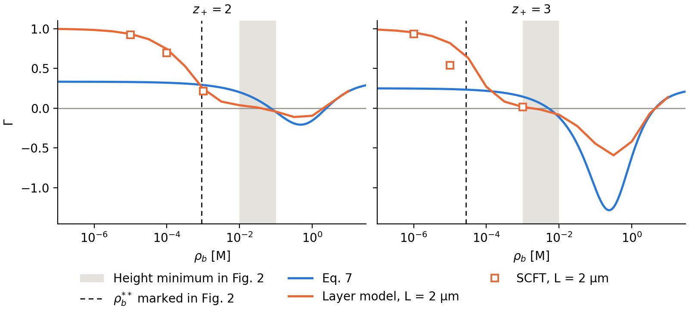

*$`\Gamma`$ against $`\rho_b`$. Eq. 7 follows the brush value only at high salt. The dashed line and the band mark where Fig. 2 has $`\rho_b^{**}`$ and the height minimum.*

### 5.2 The neutral crossing is not where Gamma vanishes

The text says that "$`\rho_b^{**}`$ is thus determined at $`\Gamma=0`$ through Eq. (7)". The paper's own figures disagree:

| $`z_+`$ | Eq. 7, $`\Gamma=0`$ | Fig. 2, $`\rho_b^{**}`$ | Ratio | Eq. 7 $`\Gamma`$ at Fig. 2 $`\rho_b^{**}`$ |
|---|---|---|---|---|
| 2 | 72 mM | 0.89 mM | 81 | +0.29 |
| 3 | 5.1 mM | 0.0275 mM | 185 | +0.23 |

Fig. 3(c) shows $`\Gamma>0`$ at 1 mM, the concentration at which Fig. 2 already has $`z_+=3`$ at its minimum.

$`f_{\rm ion}=0`$ at the neutral height is true by definition. What fails is $`f_{\rm ion}\propto\Gamma`$, because counterions C and the polymer term matter when $`\rho_b\ll\rho_P`$. In the layer model the height crosses the neutral level at $`\Gamma=+0.12`$ to $`+0.26`$ for $`z_+=2`$ and $`+0.40`$ to $`+0.46`$ for $`z_+=3`$ ($`L`$ from 0.2 to 20 µm). SCFT at $`L=6.5`$ µm gives $`\Gamma=+0.05`$ at 1 mM for $`z_+=2`$, next to the crossing, and about $`+0.16`$ at the crossing for $`z_+=3`$ by interpolation. The brush is therefore close to neutral there, particularly for $`z_+=2`$; what fails is Eq. 7, which puts $`\Gamma=0`$ almost two decades too high.

### 5.3 The lowest height is not at the Gamma minimum

The text says that at $`\partial\Gamma/\partial\rho_b=0`$ "PE brushes are compacted to the lowest height". Three checks disagree:

| | $`z_+=2`$ | $`z_+=3`$ |
|---|---|---|
| Minimum of Eq. 7 | 0.48 M, $`\Gamma=-0.21`$ | 0.24 M, $`\Gamma=-1.28`$ |
| Height minimum in Fig. 2 | 0.01–0.1 M | 1–10 mM |
| Minimum of the collapsed branch of Eq. 8, $`h\propto\rho_b/(-\Gamma)`$ | 0.18 M | 23 mM |

Line 3 of Eq. 8 has its minimum where $`d\ln|\Gamma|/d\ln\rho_b=1`$, not where the derivative vanishes, so the statement conflicts with the paper's own scaling formula. In the layer model the brush is already re-expanding while $`\Gamma`$ falls further: for $`z_+=3`$, $`L=2`$ µm, $`\log_{10}(h/h_0)`$ rises from −0.582 to −0.488 between 3.2 mM and 0.32 M while $`\Gamma`$ goes from −0.018 to −0.591.

### 5.4 The upper critical concentration

The text puts $`\rho_b^{***}`$ at $`\kappa_bb\approx1`$. That is 94, 31 and 16 mM for $`z_+=1,2,3`$. Fig. 2 marks 3.5, 1.26 and 1.04 M, where $`\kappa_bb=6.1,\ 6.3,\ 8.1`$. This is a scaling statement, so the factor of 6–8 is a weak objection, but the condition does not locate the point.

### 5.5 Eq. 6

The SI does not derive Eq. 6. Its form, $`1/[z_+(z_++1)]^3`$, follows from $`\kappa_b^3\approx\rho_b`$ with $`\kappa_b^2\propto z_+(z_++1)\rho_b`$, which replaces both $`\kappa`$ and $`\rho_+`$ in the brush by their bulk values. At the onset the brush has $`\rho_b\ll\rho_P`$, so that replacement does not hold. The numbers do not fit either:

| | Fig. 2 marks | Eq. 6 with correlations | Eq. 6 mean field |
|---|---|---|---|
| $`\rho_b^*(z_+=1)/\rho_b^*(z_+=2)`$ | 1960 | 27 | 3 |
| $`\rho_b^*(z_+=1)/\rho_b^*(z_+=3)`$ | $`7.5\times10^4`$ | 216 | 6 |

Eq. 6 falls short of the "3–6 orders of magnitude" it is said to explain.

### 5.6 Fig. 3 plots formulas, not a brush

Fig. 3 is not a calculation of the brush.

- $`\Gamma`$ is Eq. 7: the largest difference from Eq. 7 over 24 readings is 0.05.
- $`\psi_S/(\sigma Nvh^{-1})`$ is Eq. 9 with $`\rho_b`$ entered as its number in mol/L. That is 0.6022 of the correct value. Evaluated that way with the plotted $`\Gamma`$, Eq. 9 returns the plotted curve.

| $`z_+`$ | $`\rho_b`$ [M] | Fig. 3 $`\psi_S`$ | Eq. 9, $`\rho_b`$ as mol/L | Eq. 9, $`\rho_b`$ in nm⁻³ |
|---|---|---|---|---|
| 1 | 0.3 | −1.660 | −1.667 | −2.768 |
| 1 | 1 | −0.499 | −0.500 | −0.830 |
| 2 | 0.1 | −0.704 | −0.693 | −1.186 |
| 3 | 0.03 | +2.411 | +2.430 | +3.734 |
| 3 | 0.1 | +2.088 | +2.073 | +3.255 |
| 3 | 0.3 | +0.891 | +0.877 | +1.392 |

The whole table is section A of the `tables` command. Points near zero are dominated by reading error.

## 6. The low-salt onset is ion exchange

### 6.1 Mechanism

In the semicanonical ensemble of the SI, multivalent cations enter the brush only by displacing monovalent C into the box. Let $`c`$ be the C density in the far box. If $`c\gg z_+\rho_b`$, anions neutralise the far box, so $`e^{\psi_f}=(c/z_+\rho_b)e^{\Delta u_f}`$. Eliminating the brush potential from the ion densities, with $`\Delta u_B`$ and $`\Delta u_f`$ the self-energy shifts of brush and far box per unit $`z^2`$ relative to the reservoir:

```math
\rho_+=\rho_b\left(\frac{z_+\rho_b\,\rho_C}{c^2}\right)^{z_+}\exp\left[-z_+(z_+-1)\Delta u_B-2z_+\Delta u_f\right].
```

Half the C are exchanged when $`z_+\rho_+\approx\rho_C\approx\rho_P`$, and the released counterions then give $`c`$ of order $`\sigma N/L`$. Therefore

```math
\rho_b^*\propto c^{\,2z_+/(z_++1)}\propto L^{-2z_+/(z_++1)} .
```

The exponents are −4/3 for $`z_+=2`$ and −3/2 for $`z_+=3`$. Correlation changes only the prefactor, through the self-energy shifts. At half exchange this formula gives 0.88–0.98 of the layer value (`tables`, section M). For $`z_+\ge2`$, $`\rho_b^*\to0`$ as $`L\to\infty`$, so the swollen plateau of Fig. 2 is a property of the finite box. For $`z_+=1`$ the exchange swaps equal charges and $`h`$ does not respond.

### 6.2 Numbers

Onset in the layer model, defined by $`\log_{10}(h/h_0)=-0.04`$:

| $`z_+`$ | $`L=0.2`$ µm | 2 µm | 20 µm | 200 µm | Local slopes | Predicted | Fig. 2 mark |
|---|---|---|---|---|---|---|---|
| 2 | $`4.6\times10^{-4}`$ M | $`4.0\times10^{-5}`$ | $`2.0\times10^{-6}`$ | $`1.0\times10^{-7}`$ | −1.06, −1.30, −1.29 | −1.33 | $`6.9\times10^{-6}`$ |
| 3 | $`8.6\times10^{-5}`$ M | $`3.8\times10^{-6}`$ | $`1.3\times10^{-7}`$ | $`4.0\times10^{-9}`$ | −1.36, −1.48, −1.50 | −1.50 | $`1.8\times10^{-7}`$ |

The ten direct SCFT runs at $`L=0.2`$, 2 and 20 µm that converged agreed with the layer model to within 0.054 in $`\log_{10}(h/h_0)`$. Stepping $`L`$ gives every point. Values of $`\log_{10}(h/h_0)`$:

| $`z_+`$ | $`\rho_b`$ [M] | $`L=0.2`$ µm | 2 µm | 6.5 µm | 22 µm | Fig. 2 |
|---|---|---|---|---|---|---|
| 2 | $`10^{-5}`$ | −0.004 | −0.018 | −0.046 | −0.125 | −0.042 |
| 2 | $`10^{-4}`$ | −0.015 | −0.074 | −0.185 | −0.344 | −0.164 |
| 2 | $`10^{-3}`$ | −0.062 | −0.271 | −0.383 | −0.410 | −0.379 |
| 3 | $`6.3\times10^{-7}`$ | −0.002 | −0.016 | −0.054 | −0.160 | −0.072 |
| 3 | $`10^{-5}`$ | −0.011 | −0.100 | −0.254 | −0.482 | −0.276 |
| 3 | $`10^{-4}`$ | −0.048 | −0.335 | −0.530 | −0.571 | −0.522 |
| 3 | $`10^{-3}`$ | −0.230 | −0.569 | −0.572 | −0.572 | −0.584 |

Against all 24 Fig. 2 readings, the rms difference of the layer model is:

| $`L`$ | 0.2 µm | 2 µm | 20 µm | 200 µm |
|---|---|---|---|---|
| All | 0.157 | 0.050 | 0.079 | 0.159 |
| $`z_+=1`$ only | 0.009 | 0.003 | 0.004 | 0.004 |

The archived $`L=200`$ nm SCFT scan gives 0.158 on the same points, so the layer model at the same $`L`$ already explains that mismatch. There, the released counterions alone are 0.05 nm⁻³, or 83 mM of monovalent background. This is the main cause of the 0.32 ($`z_+=2`$) and 0.47 ($`z_+=3`$) maximum differences in the older reproduction report at tag `v0.10.0`.

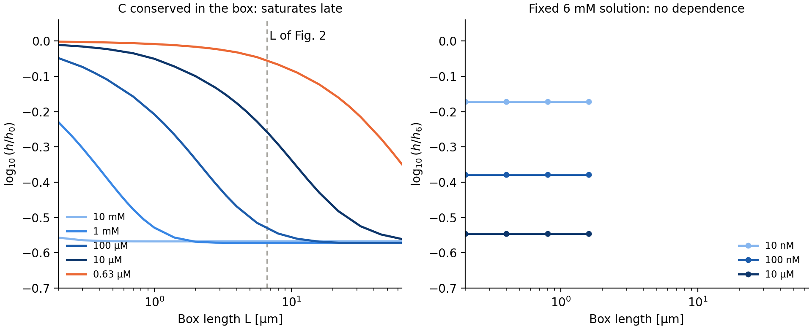

**Why the box length matters.** In a fixed solution it does not, once the box exceeds the brush and the Debye length: from 200 to 1600 nm the height at 6 mM keeps all six decimals (right panel). The calculation of Fig. 2 is different, because C are conserved. They do not fade into a bulk: released C fill the box, so $`c\approx`$ (released fraction) $`\times\,\sigma N/L`$ at any length. A longer box lowers $`c`$, which makes the exchange cheaper, so more C are released.

The height does saturate, at the collapsed value, but late (left panel): to within 0.01 at 0.3 µm at 10 mM, 2 µm at 1 mM and 16 µm at 100 µM, and past the 64 µm of the scan at 10 µM. The length grows as $`\rho_b`$ falls, in line with $`\rho_b^*\propto L^{-2z_+/(z_++1)}`$. At $`L=6.6`$ µm every reading of the fall below 1 mM is on the slope, not on the plateau. The low-salt fall of Fig. 2 is therefore a finite-box result: the trend is that a long enough box collapses the brush at any $`\rho_b>0`$ in this ensemble.

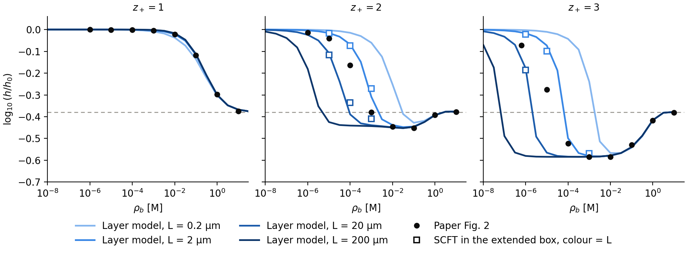

*Brush height against salt. The high-salt branch does not depend on $`L`$; the low-salt fall moves with $`L`$. Fig. 2 lies between 2 and 20 µm for $`z_+=2,3`$.*

Two earlier results point the same way. Section 3l of `archive/RESEARCH_LOG.md` (tag `v0.10.0`) found the $`z_+=2`$ neutral crossing moving as about $`L^{-1.1}`$ for $`L=400`$–1600 nm in SCFT, as the layer model does in that range (−1.13). The older report found the mean-field curves of Fig. 1 agreeing to 0.0027 with a salt-only grand-canonical control, which is the limit of a large box.

### 6.3 One box length reproduces Fig. 2

$`L`$ was stepped from 0.2 to 64 µm in ratios of about 1.4, each solve starting from the last. All readings below 1 M converged, including the four points where a direct jump from $`L=200`$ nm had failed. The readings at 1 and 10 M do not depend on $`L`$. Stepping down from 64 µm returns the same solutions, to $`3.4\times10^{-7}`$ nm in height at 66 points, so only one branch is involved.

| Readings | Best common $`L`$ [µm] | rms | $`L`$ with rms within 0.002 of the best [µm] |
|---|---|---|---|
| All 24 | 6.66 | 0.0115 | 5.80–7.56 |
| $`z_+=1`$, 8 readings | Not determined | 0.0068 | Any from 3 to 12 |
| $`z_+=2`$, 8 readings | 5.60 | 0.0098 | 4.99–6.36 |
| $`z_+=3`$, 8 readings | 7.22 | 0.0117 | 6.58–7.92 |
| The fall: $`z_+=2,3`$ at $`\rho_b\le1`$ mM | 6.66 | 0.0135 | 6.14–7.22 |

Direct solutions at $`L=6.5`$ µm give rms 0.0116 and a largest difference of 0.022 over the 24 readings, whose reading uncertainty is about 0.01. The width of the fall also agrees: 1.19 and 1.09 decades from −0.1 to −0.3, against 1.15 and 1.13 in Fig. 2. The layer model gives a narrower fall, 0.77 and 0.56 decades, which is a limit of that model.

The box length needed at each reading:

| $`z_+`$ | $`\rho_b`$ [M] | Fig. 2 | $`L`$ needed [µm] | $`c`$ there [mM] |
|---|---|---|---|---|
| 2 | $`10^{-6}`$ | −0.013 | 6.44 | 0.14 |
| 2 | $`10^{-5}`$ | −0.042 | 5.78 | 0.44 |
| 2 | $`10^{-4}`$ | −0.164 | 5.49 | 1.51 |
| 2 | $`10^{-3}`$ | −0.379 | 6.08 | 2.58 |
| 3 | $`6.3\times10^{-7}`$ | −0.072 | 8.64 | 0.27 |
| 3 | $`10^{-5}`$ | −0.276 | 7.33 | 1.24 |
| 3 | $`10^{-4}`$ | −0.522 | 6.11 | 2.53 |

$`L`$ stays within a factor of 1.6 while $`c`$ changes 18-fold. That is what a conserved amount of C in a fixed box gives: $`c`$ rises as C are released.

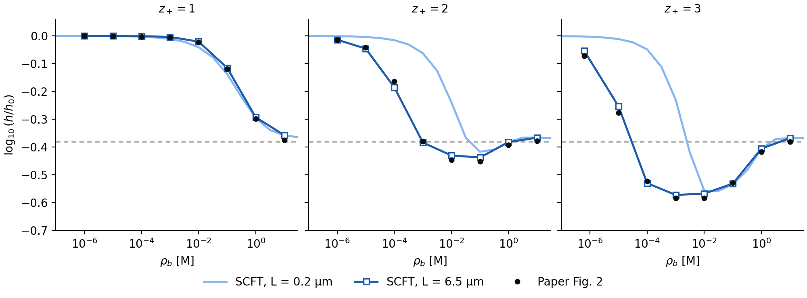

*Readings of Fig. 2 against SCFT. One box length serves all three valences.*

Other causes tested:

- **Fixed monovalent background.** With a grand-canonical 1:1 salt in place of canonical C, the best common value leaves rms 0.076 on the eight readings of the fall (40 mM, salt-free $`h_0`$) or 0.091 (25 mM, $`h_0`$ with the same background), against 0.0135 for a common $`L`$. Fitted separately, $`z_+=2`$ wants 9–10 mM and $`z_+=3`$ wants 36–50 mM.
- **Graft width.** A width of 0.125 nm instead of 0.5 nm gives rms 0.0111 and moves single readings by at most 0.002.
- **Far boundary.** Not the cause ([10.2](#102-values-found-in-the-groups-other-work)).

What this shows and does not show:

- The ensemble stated in the SI, with one number added, reproduces Fig. 2 to about its reading uncertainty. Canonical C and the local-density closure are enough. Neither the nonlocal $`G`$ nor $`I_{ex}`$ is needed for this figure.
- $`L`$ is fitted, not derived. Only $`\sigma N/L`$ enters, here $`1.5\times10^{-3}`$ nm⁻³, or 2.5 mM of C averaged over the box. Equilibrium does not fix $`L`$: it is the amount of solution per unit brush area, and $`L\to\infty`$ gives $`\rho_b^*\to0`$. The onset positions of Fig. 2, and the "3–6 orders of magnitude" comparison with experiment, therefore rest on this unreported number.
- How the authors reached this value is unknown. A real grid of 6.6 µm would be unusual: the group's public mean-field code defaults to $`L_z=50`$ nm. A far region counted as a volume, as done here, would be equivalent.
- The experiment does not supply it ([6.7](#67-cross-checks-at-the-experiments-solution)).
- A small difference remains. From 10 mM up, SCFT lies 0.011–0.018 above the readings at 8 of the 12 points. Graft width does not explain it.

### 6.4 The experiment in Fig. 2

The symbols of Fig. 2 are those of Fig. 7 of Yu et al., Macromolecules 49, 5609 (2016), with the older $`{\rm Y}^{3+}`$ data of its ref. 33. The paper leaves out four of its conditions:

- **Solution.** The $`{\rm Y}^{3+}`$ series was run at a fixed ionic strength of 6 mM by mixing $`{\rm NaNO_3}`$ and $`{\rm Y(NO_3)_3}`$, for example 5.94 mM $`{\rm NaNO_3}`$ with 0.01 mM $`{\rm Y^{3+}}`$. The monovalent density in the experiment is therefore known, and it does not come from released counterions.
- **Reference.** $`h_0`$ is not salt-free: it is the height in 6 mM $`{\rm NaNO_3}`$ for $`{\rm Y}^{3+}`$, in 3 mM $`{\rm NaNO_3}`$ for the divalent ions and in $`{\rm D_2O}`$ for $`{\rm Na}^+`$.
- **Chain.** The brush mass of 25 mg/m² is about 73 charges per nm², so $`N\approx730`$ at their rough estimate of $`\sigma\approx0.1`$ nm⁻². The height is 250–300 nm. The paper takes only $`\sigma`$ from the experiment. With this $`\sigma N`$, the $`c`$ of [6.3](#63-one-box-length-reproduces-fig-2) would need $`L\approx48`$ µm.
- **Height.** Yu et al. take the distance where the scattering length density reaches $`6.2\times10^{-6}`$ Å⁻², the outer edge of the film, not a moment of the profile.

SCFT at the experiment's solution, with a fixed 1:1 background, $`N=100`$ and the height relative to 6 mM 1:1 salt as in the experiment. Fig. 7 is read by eye, about ±0.02. The last column is the $`{\rm Y}^{3+}`$ share of the brush charge from a Donnan balance at $`\rho_P=0.2`$ nm⁻³ with no correlation:

| $`{\rm Y}^{3+}`$ [M] | $`{\rm NaNO_3}`$ [mM] | Fig. 7 of Yu et al. | SCFT in that solution | Share without correlation |
|---|---|---|---|---|
| $`10^{-6}`$ | 5.99 | −0.09 | −0.494 | 0.38 |
| $`10^{-5}`$ | 5.94 | −0.145 | −0.546 | 0.65 |
| $`10^{-4}`$ | 5.40 | −0.495 | −0.560 | 0.84 |
| $`5\times10^{-4}`$ | 3.00 | −0.545 | −0.561 | 0.95 |


*Blue and orange are relative to the height in 6 mM 1:1 salt, the grey line of the paper to its salt-free brush. The arrow is taken at half of the collapse, where the experiment value is interpolated between 10 and 100 µM.*

The model has collapsed by 1 µM. The experiment collapses between 10 and 100 µM. The Donnan column gives the uptake without correlation. It does not give the height: a brush can hold most of its charge as $`{\rm Y}^{3+}`$ and stay swollen, see [6.7](#67-cross-checks-at-the-experiments-solution).

The line of Fig. 2 passes near the data because the calculation has no $`{\rm Na}^+`$ background and because its $`\rho_b`$ is not the concentration in its box ([6.7](#67-cross-checks-at-the-experiments-solution)). Its only monovalent ions outside the brush are released C, at 0.27 mM where the experiment has 6 mM. The agreement is therefore not a test at the experiment's condition.

**Box length against the symbols.** The main text and SI do not say how the box was set, and neither uses "fitted" or "adjustable". The conclusion calls the results "theoretical predictions that are in quantitative agreement with the experimental data". To compare, $`L`$ was fitted to the experimental symbols with the same calculation as [6.3](#63-one-box-length-reproduces-fig-2): canonical C and no $`{\rm Na}^+`$ background.

| Fitted to | Best $`L`$ [µm] | rms | Range of $`L`$ [µm] | rms at 6.6 µm |
|---|---|---|---|---|
| Lines of Fig. 2, 24 readings | 6.66 | 0.0115 | 5.80–7.56, best + 0.002 | |
| $`{\rm Y}^{3+}`$ fall, 4 symbols | 4.09 | 0.026 | 3.3–5.0, best + 0.01 | 0.059 |
| All $`{\rm Y}^{3+}`$, 7 symbols | 4.09 | 0.026 | 3.2–5.4, best + 0.01 | 0.048 |
| $`{\rm Ba}^{2+}`$, 2 symbols | 64, the end of the scan | 0.025 | 11.7–64, best + 0.01 | 0.048 |
| $`{\rm Y}^{3+}`$ and $`{\rm Ba}^{2+}`$, 9 symbols | 4.62 | 0.038 | 3.3–6.6, best + 0.01 | 0.048 |

The symbols are read by eye, about ±0.02, and the calculation is interpolated between concentrations a decade apart. The larger range is used for them because of this reading uncertainty.

The value behind the lines is within a factor of 1.6 of the best value for the $`{\rm Y}^{3+}`$ symbols, the ranges for all nine symbols and for the lines overlap, and it is more than 100 times the 50 nm default of the group's public code. This is what would be expected if the box had been set with the data in view. It is not evidence of how the box was set: another setting that gives the same $`\sigma N/L`$ would look the same, and only the authors can say.

- **Cause of the late collapse.** It is not chain length ([6.5](#65-chain-length-and-the-two-layer-collapse)). A limited supply of $`{\rm Y}^{3+}`$ in a finite pool is the best single account ([6.6](#66-closed-cell), [6.7](#67-cross-checks-at-the-experiments-solution)); the depth is fitted, so a deeper pool with a weaker self-energy is not excluded.
- **Monovalent ions.** The experiment stays at $`h_0`$ up to about 1 M; Yu et al. place the salted regime above 2 M for this brush. Fig. 2 has $`\rho_b^*=13.5`$ mM for $`z_+=1`$, two decades lower.
- **Divalent ions.** Fig. 2 shows only $`{\rm Ba}^{2+}`$, the strongest of three. At 33 mM the brush is collapsed in $`{\rm Ba}^{2+}`$ and swollen in $`{\rm Mg}^{2+}`$, and the onsets differ by at least two decades. Yu et al. attribute this to ion binding, which the model does not contain.

### 6.5 Chain length and the two-layer collapse

SCFT at ionic strength 6 mM with $`\sigma=0.1`$ nm⁻². A step straight to $`N=730`$ fails, from $`N=100`$ or from $`N=339`$, so $`N`$ was raised in 5 % steps at fixed $`\rho_b`$, up to $`N=339`$ at ten concentrations and $`N=500`$ at $`10^{-6}`$ M. $`N=730`$ below is a $`1/N`$ fit from $`N\ge198`$. A walk in $`\rho_b`$ at $`N=730`$ from the swollen state reaches 3.32 nM directly. The fit agrees with that walk at 3 nM to all digits shown. $`f=3\Gamma_Y/(\sigma N)`$ is the fraction of the brush charge taken up as excess $`{\rm Y}^{3+}`$.

| $`\rho_b`$ [M] | $`f`$, $`N=100`$ | 339 | 730 | $`h/N`$ [nm], $`N=100`$ | 339 | 730 |
|---|---|---|---|---|---|---|
| $`3\times10^{-9}`$ | 0.069 | 0.073 | 0.074 | 0.460 | 0.451 | 0.450 |
| $`5\times10^{-9}`$ | 0.170 | 0.192 | 0.197 | 0.405 | 0.389 | 0.386 |
| $`10^{-8}`$ | 0.336 | 0.357 | 0.362 | 0.334 | 0.321 | 0.319 |
| $`3\times10^{-8}`$ | 0.546 | 0.562 | 0.566 | 0.258 | 0.249 | 0.247 |
| $`10^{-7}`$ | 0.705 | 0.717 | 0.720 | 0.207 | 0.200 | 0.199 |
| $`3\times10^{-7}`$ | 0.804 | 0.813 | 0.815 | 0.178 | 0.173 | 0.172 |
| $`10^{-6}`$ | 0.877 | 0.883 | 0.885 | 0.159 | 0.154 | 0.153 |

From $`N=100`$ to 730, $`f`$ moves by at most 0.027 and $`h/N`$ by at most 5 %. At 1 µM, $`\log_{10}(h/h_6)`$ goes from −0.494 to −0.505, where $`h_6`$ is the height in 6 mM 1:1 salt: 49.6 nm at $`N=100`$ and 357 nm at $`N=730`$. The gap to the experiment is therefore not from $`N`$.

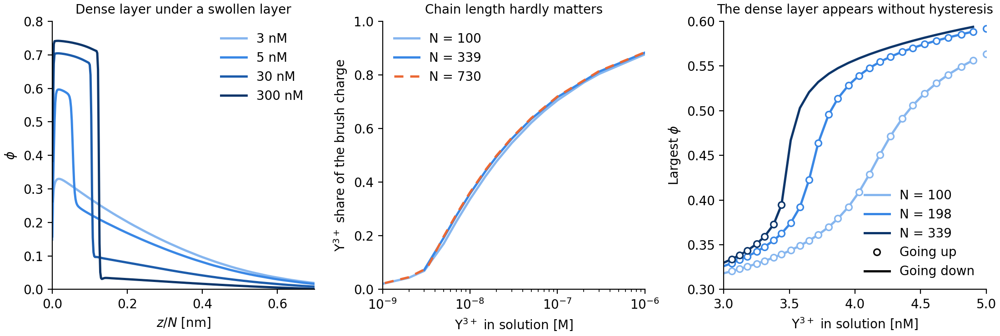

**What $`N`$ does.** $`b`$, $`\sigma`$ and the charge per bead stay fixed in nm, so raising $`N`$ adds polymer and charge per area. $`N`$ sets a length and an amount, and little else:

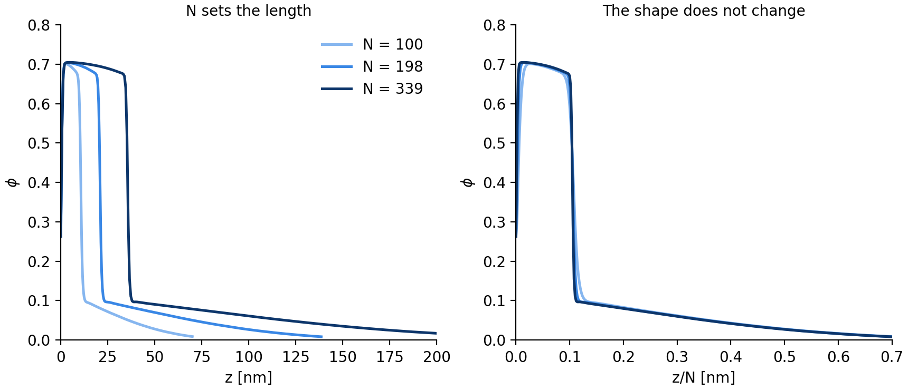

- **Length.** The profile is a function of $`z/N`$, so $`h\propto N`$ (figure above). Relative heights such as $`h/h_6`$ do not change.
- **Amount.** The charge per area is $`\sigma N`$, which sets how much $`{\rm Y}^{3+}`$ the brush can take from a finite solution. Only $`\sigma N/D`$ enters [6.6](#66-closed-cell), as only $`\sigma N/L`$ enters [6.3](#63-one-box-length-reproduces-fig-2).
- **Local state.** Local density and uptake $`f`$ hardly depend on $`N`$, because ion exchange depends on local densities.
- **What remains.** The Debye length, $`a`$ and $`b`$ are fixed in nm and do not scale with $`N`$. They give the $`1/N`$ corrections, and the front keeps its width in nm, so it is sharper in $`z/N`$ at larger $`N`$.

**Two layers.** The collapse is not a uniform shrinking (first panel). A dense wall layer appears between 3 and 5 nM and thickens with $`\rho_b`$, under a swollen layer with a sharp front between them. At $`N=100`$ its thickness with $`\phi>0.4`$ goes from 0 at 3 nM to 4.9 nm at 5 nM, 8.0 nm at 10 nM, 11.6 nm at 100 nM and 13.5 nm at 500 µM, and $`\phi_{\rm max}`$ from 0.32 to 0.76. At 30 nM the two layers have $`\phi\approx0.7`$ and 0.1.

**Onset of the dense layer.** $`\rho_b`$ was stepped by 2 % from 3 to 5 nM and back at fixed $`N`$:

| $`N`$ | Largest $`\phi_{\rm max}`$ step | Between [nM] | Largest height difference, up against down [nm] | Going up |
|---|---|---|---|---|
| 100 | 0.022 | 4.11–4.19 | $`2.2\times10^{-6}`$ | Reaches 5 nM |
| 198 | 0.041 | 3.65–3.72 | $`3.1\times10^{-6}`$ | Reaches 5 nM |
| 339 | 0.072 | 3.44–3.51 | $`6.5\times10^{-6}`$ | No convergence at 3.51 nM |

Up and down give the same solutions, so there is one branch and no hysteresis up to $`N=339`$. At $`N=339`$ the walk down crosses the step that the walk up cannot, so that failure is the solver's and not a missing solution. The walk at $`N=730`$ stops at about the same place, above 3.32 nM. The step sharpens with $`N`$, and whether it stays continuous at $`N=730`$ was not solved. It would change $`f`$ by little: at $`N=339`$, from 0.091 to 0.099 across the largest step.

**Against the measured profiles.** Yu et al. fit parabolic profiles at 1 and 10 µM. The swollen state here has that shape, but the closed cell of [6.6](#66-closed-cell) puts 10 µM past the onset, with a dense wall layer they do not report. Their collapsed film is Gaussian-like with its peak near the middle of the film, and they point to pinned micelles, a lateral structure. The SCFT collapsed state is a box against the wall, and a one-dimensional calculation cannot have lateral structure. The film thicknesses are of the right size, 96 nm at $`N=730`$ against about 80 nm collapsed and 357 nm against 250–300 nm swollen. This uses $`v=1`$ nm³, while 25 nm of dry film over 73 monomers per nm² gives 0.34 nm³, so the collapsed film has $`\phi\approx0.3`$ in the experiment and 0.76 in the model.

### 6.6 Closed cell

The solution holds a finite amount of $`{\rm Y}^{3+}`$. With a depth $`D`$ of solution over unit brush area, what is added is shared between solution and brush:

```math
\rho_{\rm added}=\rho_b+\frac{f(\rho_b)\,\sigma N}{3D},\qquad \sigma N=73\ {\rm nm^{-2}}.
```

This is a balance on the $`f(\rho_b)`$ calculated above at a fixed background; it needs no new SCFT solve. The $`{\rm Na}^+`$ released is about 0.1 mM and is ignored. Heights are $`\log_{10}(h/h_6)`$, $`D`$ is fitted to the four symbols.

| $`{\rm Y}^{3+}`$ added [M] | Fig. 7 of Yu et al. | Unlimited solution, $`N=730`$ | $`D=1.21`$ mm, $`N=100`$ | $`D=1.17`$ mm, $`N=730`$ | $`\rho_b`$ at $`N=730`$ [M] |
|---|---|---|---|---|---|
| $`10^{-6}`$ | −0.09 | −0.505 | −0.013 | −0.013 | $`1.2\times10^{-9}`$ |
| $`10^{-5}`$ | −0.145 | −0.557 | −0.153 | −0.149 | $`7.3\times10^{-9}`$ |
| $`10^{-4}`$ | −0.495 | −0.570 | −0.557 | −0.568 | $`6.6\times10^{-5}`$ |
| $`5\times10^{-4}`$ | −0.545 | −0.571 | −0.560 | −0.571 | $`4.7\times10^{-4}`$ |
| rms | | 0.295 | 0.050 | 0.054 | |

The range of $`D`$ within rms + 0.01 is 0.63–1.71 mm at $`N=730`$. A fresh solution at each reading gives $`D=1.08`$ mm and rms 0.055. At this depth the brush nearly empties the solution: at 1 and 10 µM added, the bulk keeps about 0.1 % of the $`{\rm Y}^{3+}`$.

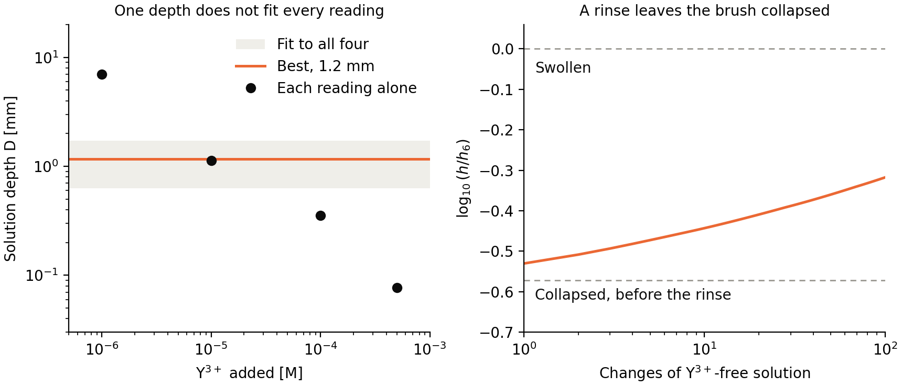

One depth does not fit all four (left panel). Each reading alone needs $`D=7.0`$, 1.1, 0.36 and 0.077 mm at $`N=730`$, from low to high concentration.

**The cell.** Scheme 1a of Yu et al. shows the wafer over a Teflon trough of $`{\rm D_2O}`$ solution, with no inlet or outlet, so a finite pool is the right picture. The scheme is not to scale and no depth or volume is given. Over the 3 inch wafer, 1.2 mm is about 5.5 mL. The text says Y³⁺ was added to the solution, and it does not say whether a new solution was used at each step, so both variants above are possible.

**Rinsing** (right panel). Yu et al. report that the collapsed brush stays collapsed when the solution is replaced by 6 mM $`{\rm NaNO_3}`$, and that it recovers after 3 M $`{\rm NaNO_3}`$. In their force measurement the range recovers in part on the same change, from 80 to 150 nm. The same balance with no $`{\rm Y}^{3+}`$ in the new solution, $`D=1.17`$ mm, $`N=730`$, started from 500 µM:

| Solution changes | $`f`$ | $`\log_{10}(h/h_6)`$ |
|---|---|---|
| 1 | 0.923 | −0.530 |
| 3 | 0.868 | −0.493 |
| 10 | 0.796 | −0.443 |
| 30 | 0.714 | −0.388 |
| 100 | 0.600 | −0.318 |

The collapsed brush keeps its $`{\rm Y}^{3+}`$ with no binding and no slow kinetics, because the bulk in balance with it is so dilute that each change carries little away. This is a second observation explained by the same depth. Yu et al. do not give the number of changes, and 3 M $`{\rm NaNO_3}`$ was not calculated.

**Height definition.** The outer edge in place of $`2\langle z\rangle`$ does not close the gap. The threshold in the model is uncertain: with the usual scattering length densities of $`{\rm D_2O}`$ and polystyrene sulfonate, not stated in the paper, 6.2 is about $`\phi=0.03`$, which is 0.09 in units of the model's $`v`$.

| Height | Unlimited solution, rms | Best $`D`$ [mm] | Closed cell, rms |
|---|---|---|---|
| $`2\langle z\rangle`$ | 0.295 | 1.17 | 0.054 |
| Outer edge at model $`\phi=0.03`$ | 0.413 | 0.33 | 0.100 |
| Outer edge at model $`\phi=0.05`$ | 0.364 | 2.0 | 0.076 |
| Outer edge at model $`\phi=0.09`$ | 0.290 | 1.41 | 0.043 |

A limited supply can therefore reproduce the $`{\rm Y}^{3+}`$ fall with one fitted number. It is not shown to be the cause: the depth is fitted, one depth does not fit all readings, the rms is above the ±0.02 of the readings, the profile at 10 µM disagrees, and slow uptake, ion pairing in solution and lateral structure are not excluded. The experiment that would test it is the same titration at a known, varied solution depth.

### 6.7 Cross-checks at the experiment's solution

Two cheaper calculations test the numbers above. One is a uniform layer in a neutral solution of $`{\rm Na}^+`$, $`{\rm Y}^{3+}`$ and $`{\rm NO_3}^-`$ (command `uniform6`), with no chain propagator. The other is SCFT with the self-energy switched off (`walk --mean-field`). Heights are relative to the same calculation in 6 mM 1:1 salt.

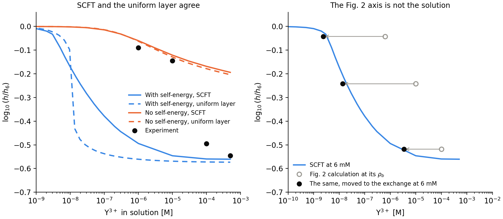

- **The early collapse is what the model says.** With the self-energy, the uniform layer falls between 10 and 14 nM and the SCFT height halves near 30 nM (left panel, blue). The two lie within a factor of about three, three decades below the experiment, so it is not a numerical error.
- **In an unlimited solution, mean field fits the two lowest symbols.** Without the self-energy and with nothing fitted, SCFT gives −0.060 and −0.121 and the uniform layer −0.062 and −0.129, against −0.09 and −0.145 (orange). Half exchange falls at about 3 µM, which also follows by hand from $`\rho_Y\approx\tfrac43c^3/\rho_P^2`$.
- **Uptake alone does not collapse the brush.** Mean field stops at −0.19 at 500 µM with 94 % of the brush charge carried by $`{\rm Y}^{3+}`$. The fall in the experiment therefore needs an attraction, which in this model is the self-energy.
- **The self-energy moves the uptake by two decades.** Uptake $`f=0.6`$ needs 8.7 µM without it and 43 nM with it, a gain of 5.3 $`kT`$ per $`{\rm Y}^{3+}`$. So the model gets its collapse, but about three decades early. In the dense state the closure is not controlled ([section 8](#8-neglected-terms-and-range-of-validity)), so this gain may be too large.
- **The axis of Fig. 2 is not the solution.** In the calculation of Fig. 2 the box holds C with no anion of its own, so the far region sits at $`\psi_f=\ln[c/(z_+\rho_b)]>0`$ against the reservoir and repels $`{\rm Y}^{3+}`$. The concentration in the box is $`\rho_be^{-3\psi_f}`$: at $`\rho_b=10`$ µM it is 0.14 nM. Moving each point to that concentration, and to $`c=6`$ mM with the exchange law $`\rho/c^3`$, puts three points within 0.04 of the 6 mM curve (right panel, all relative to the same $`h_6`$). The fourth, at $`\rho_b=1`$ mM, moves to 6 mM $`{\rm Y}^{3+}`$, more than a solution of ionic strength 6 mM holds. The three decades between the two are this potential, not different physics. In the experiment the solution is neutral and what is added is what is there.
- **$`L`$ cannot be read from the experiment.** In the calculation $`L`$ sets $`c`$, and $`c`$ sets $`\psi_f`$. The experiment has no such potential, because its monovalent ions are a neutral salt. Read as a solution depth, $`L`$ would be the millimetres of [6.6](#66-closed-cell), and released C would be about 0.1 mM. Read as a monovalent density, $`\sigma N/L=6`$ mM gives 2.8 µm at $`N=100`$ and 20 µm at $`N=730`$. That is the order of the fitted 6.6 µm, but a fixed background of that kind does not reproduce Fig. 2 ([6.3](#63-one-box-length-reproduces-fig-2)).

**The fair comparison is a closed cell for both** ([6.6](#66-closed-cell)), because the solution of the experiment is a finite pool.

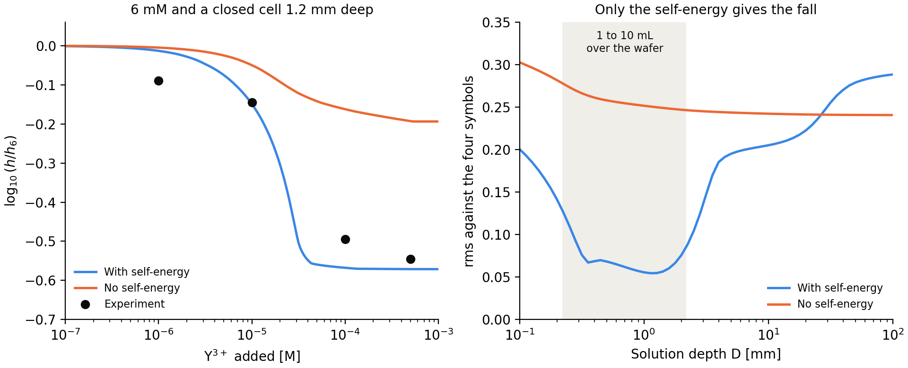

Without the self-energy the brush never collapses at any depth, with rms 0.24 against the four symbols. Its fit to the two lowest symbols holds only in a pool 20 mm deep or more, about 90 mL over the wafer. With the self-energy one depth near 1.2 mm, about 5.5 mL, follows all four. At the experiment's solution in a closed cell, the model with its self-energy is therefore the best single description.

The fitted depth stays the weak point, and a deeper pool with a weaker self-energy would look the same. The depth of the trough decides between them: near 1 mm supports the model as it stands, and at 7 mm, where its rms is 0.20, the self-energy would be too strong. None of this comes from a calculation of the paper.

## 7. What the model does

### 7.1 What holds

- From 10 mM up, the layer model at $`L=20`$ µm matches Fig. 2 to 0.011 at all 12 readings for $`z_+=1,2,3`$, with nothing fitted but $`L`$, which has no effect there. Its minima are −0.452 and −0.584, against −0.451 and −0.584 in Fig. 2.
- The neutral level is reproduced: −0.377 and −0.378 against −0.38.
- Without the self-energy there is no collapse. In the mean-field layer the height falls monotonically to the neutral level from above.

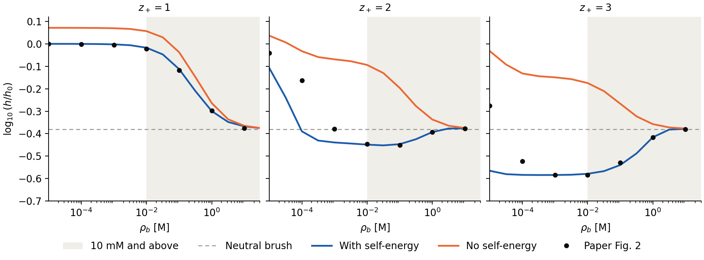

*Both curves are relative to the salt-free brush with the self-energy. Only with the self-energy (blue) does the height go below the neutral brush for $`z_+=2,3`$ and come back. In the grey band blue follows the readings. To the left of it the curve is for $`L=20`$ µm, not the $`L`$ of [6.3](#63-one-box-length-reproduces-fig-2), so it need not follow them there.*

### 7.2 What drives the fall

The sequence for $`z_+\ge2`$ is exchange, then attraction.

Exchange first removes the counterion pressure. Without correlations it gives a plateau at $`h\propto z_+^{-1/2}`$: at $`L=20`$ µm the mean-field layer reaches −0.140 and −0.221 at 1 mM, against $`-\tfrac12\log_{10}z_+=-0.151,\ -0.239`$. With correlations, the same brush then has $`\Gamma\approx0`$ and a negative correlation pressure, and it passes below the neutral level.

In the layer model at $`L\ge2`$ µm, the height minimum sits at $`\Gamma\approx0`$ (between −0.018 and +0.009 on a half-decade grid, in a flat valley). The paper places $`\Gamma=0`$ at the neutral crossing and the minimum at the most negative $`\Gamma`$.

### 7.3 Surface potential

Using the potential relative to the far box:

- $`z_+=2`$: it stays negative at all salt concentrations, in the layer model and in SCFT, while the brush collapses and re-expands. This confirms the paper's conclusion that the two are not causally tied.
- $`z_+=3`$: it changes sign twice. At the upper end the sign change (1–3 M) is separated from $`\Gamma=0`$ (3–10 M), as Eq. 9 says. At the lower end the sign change and $`\Gamma=0`$ fall in the same half decade of the layer scan: 1–3.2 mM at $`L=2`$ µm and 0.3–1 mM at $`L=20`$ µm. The statement that they are out of sync therefore holds only at high salt.

The sign of $`\psi`$ relative to the reservoir differs at low salt, because the far box itself is at $`\psi_f=\ln[c/(z_+\rho_b)]>0`$. The paper does not state its reference.

## 8. Neglected terms and range of validity

**Monomer screening.** The paper drops $`u_P^{\rm ex}`$ and does not mention $`I_{ex}`$. Dropping one consistently drops the other, because $`I_{ex}`$ is its derivative with respect to $`G`$, and the sister paper does exactly that. Each monomer then screens like a free ion. A Gaussian-chain RPA estimates the size of the change in correlation pressure:

| $`z_+`$ | $`\rho_P`$ [nm⁻³] | $`\rho_b`$ [nm⁻³] | $`P_{\rm corr}`$, paper's local form | With form factor $`S_1(k)`$ |
|---|---|---|---|---|
| 1 | 0.20 | 0.18 | −0.113 | −0.167 |
| 2 | 0.50 | 0.02 | −0.272 | −0.355 |
| 3 | 0.35 | 0.002 | −0.235 | −0.302 |
| 3 | 0.70 | 0.002 | −0.499 | −0.583 |
| 3 | 0.70 | 0.06 | −0.628 | −0.703 |

With the form factor the pressure is 12–48 % more negative. This is an upper estimate, because brush chains are stretched. The effect on self-energies is small: −0.01 to −0.05 per monomer and −0.05 to −0.19 per cation at $`\kappa\ge2.6`$ nm⁻¹. The omission is not qualitatively fatal, but it does not fit "fully captured". Taken into the self-consistent brush with the form factor of a chain tethered at the wall, the local closure finds no state beyond 0.25 of the way from free segments to the chain salt-free and beyond 0.35 in 6 mM $`{\rm NaNO_3}`$ ([MultivalentBrush.md](MultivalentBrush.md#what-the-model-leaves-out)).

**The premise for dropping $`u_P^{\rm ex}`$.** The text says it is less important than $`u_P^0`$ at high ionic strength. For the central monomer of an unperturbed Gaussian chain, $`|u_P^{\rm ex}/\Delta u_P^0|`$ is 0.41 at $`\kappa=4`$ nm⁻¹, 1.9 at 2 nm⁻¹ and 7.7 at 1 nm⁻¹. The premise holds for $`\kappa\gtrsim3`$ nm⁻¹, as in the collapsed state, and not obviously in the swollen brush. This compares magnitudes for an unstretched chain, so it is a caution and not a contradiction.

**The first-cumulant closure.** S17 replaces $`\langle e^{-H^{\rm ex}}\rangle_0`$ by $`e^{-\langle H^{\rm ex}\rangle_0}`$, which needs small $`H^{\rm ex}`$. The same estimate gives $`u_P^{\rm ex}=2.3`$ per monomer at $`\kappa=1`$ nm⁻¹ and 6.1 at 0.3 nm⁻¹, so the closure is not controlled at low ionic strength, where the chain energy is of order $`N`$ times that.

**No variational bound.** The action is complex, so the Gibbs-Bogoliubov inequality does not hold. The Gaussian reference gives a stationary point, not an upper bound, and the theory cannot measure its own error. In a uniform electrolyte it equals the one-loop result. For monovalent ions at $`\ell_B\kappa=2.15`$, CL-FTS of the same model gives an excess chemical potential 2 % below one loop, and at 2.3 CL-FTS agrees with exact Monte Carlo by Widom insertion ([Electrolytes.md](../../../docs/validation/Electrolytes.md)).

**Density fluctuations.** Only $`\Psi`$ fluctuates; $`W_K`$ and $`\Xi`$ stay at their saddle points. Monomers and ions therefore screen as if they could move freely, which an incompressible dense layer does not allow. A hand estimate at $`\phi=0.7`$ lowers $`\kappa`$ by about 8 % and the gain from correlation by about 4 %. A one-loop calculation with the compressibility of water lowers $`u`$ of the ions in the collapsed layer by 3.6 %, but the self-energy of the segments then depends on the shape given to a segment and does not converge as the compressibility goes to zero ([MultivalentBrush.md](MultivalentBrush.md#what-the-model-leaves-out)).

**Strength of the coupling.** In the collapsed $`z_+=3`$ state at 1 mM, the layer model has $`\phi=0.77`$ and $`\kappa=5.2`$ nm⁻¹. So $`1/\kappa=0.19`$ nm is below $`a=0.25`$ nm and well below the monomer size, $`\kappa a=1.3`$, and $`z_+^2\ell_B\kappa\approx33`$. A quantitative match to Fig. 2 there is a match to the closure, not evidence that the closure is accurate at this coupling. This is a judgement, not a proof.

Earlier sampling in the same folder pointed to a weaker effect than the Gaussian theory predicts, but neither study settles it. The CL runs failed an exact finite-model benchmark, and the planar MC drops transverse charge fluctuations. The size of the error at this coupling is unmeasured.

## 9. Code

| Check | Result |
|---|---|
| `duan_scft.py` against the SI, line by line: $`u_K`$, $`\kappa`$, $`\xi=-\ln(1-\phi)-\chi\phi`$, $`\omega_P`$, Poisson–Boltzmann and its Jacobian, chain, `gamma_algebraic`, nonlocal $`G`$ | Match |
| `prl_electrolyte.py` and `literature_scft.py` against the Agrawal SI: $`\mu_{\rm corr}`$, $`f_{\rm corr}`$, pressure, critical point, Galvani potential, wall boundary condition and Jacobian, interface normalisation | Match |
| All 57 archived Fig. 2–3 solutions against independent code | Chain ≤ $`7.2\times10^{-14}`$, Poisson ≤ $`9.5\times10^{-9}`$, self-energy ≤ $`3.2\times10^{-8}`$, field ≤ $`2.0\times10^{-8}`$ |
| `workflow.py prl salt` from the restored tag, $`z_+=3`$, 10 mM | $`h=14.122885939812836`$ nm, identical to the archive |
| `duan_scft_check.py scft`, $`z_+=2`$ and 3, 1 mM, $`L=2`$ µm | Identical to the earlier run |
| `duan_scft_check.py walk`, $`z_+=3`$: 1 M at $`L=6.5`$ µm with both graft widths, 1 mM with 0.3 M background | Identical to the scan |
| [BrushMultivalentIons1D.py](../BrushMultivalentIons1D.py), continuous chain with `cn-adi2`, the same equations in new code | 24 readings at $`L=6.6`$ µm, rms 0.0113 against 0.0116 here; closed cell −0.013, −0.149, −0.555, −0.558 |
| Chain ladder to $`N=339`$ fitted to $`N=730`$ against a direct solve at 3 nM | $`f`$ 0.0740 and 0.0740, $`h`$ 328.16 and 328.11 nm |
| `literature_scft.py` from the restored tag, six cases | Identical to the earlier runs |
| `workflow.py analyze electrolyte` on the archived campaign | All 1644 numbers identical to the earlier analysis |

Electrolyte results against the Agrawal papers, reproduced by that analysis:

| Quantity | Difference |
|---|---|
| Coexistence, largest relative | 0.647 % |
| Galvani potential, largest absolute | 0.00174 |
| Wall potential, $`\sigma=-0.01`$ | $`4.7\times10^{-5}`$ |
| Wall potential, $`\sigma=-0.0244`$ | $`2.06\times10^{-4}`$ |
| Wall potential, $`\sigma=-0.0245`$ | 0.145 |
| Interface profile, aligned at the midpoint | 1.78 % of the span |

Passing these checks verifies the coded model. The coded model is the smoothed local-density closure, not the paper's full theory. The differences and limits are:

- **Chain.** [`_chain_density_rs`](../models/duan_scft.py#L365) is wrong at 4 of the 57 archived fields, by up to 0.19 nm⁻³: $`z_+=1`$ at $`10^{-7}`$, $`10^{-6}`$ and 3.16 M, and $`z_+=2`$ at $`10^{-7}`$ M. These four have a contrast of 715–739 $`kT`$ over the chain, where bead slices fall to the `1e-300` floor. The accepted scan used `extended_chain` in `prl_runs.py`, so its numbers are unaffected. The model is unsafe on its own in that range.
- **Nonlocal backend.** Against S33 in a uniform state it is high by 1.0–1.5 % at `nq=64`, `dz=0.125`, and by 0.15–0.33 % at `nq=256`, `dz=0.0625`.
- **Wall term in the nonlocal backend.** A Neumann image adds +0.12 to +0.63 per $`z^2`$ at the wall and grows as `dz` shrinks. Uniform $`\epsilon`$ has no image charge, so this term is not in the model as stated. The LDA scans do not use this backend.
- **Modelling differences from the paper.** The graft is a half-Gaussian of width $`0.5b`$, not a delta function. $`I_0`$ is smoothed over $`a`$. $`L=200`$ nm is our choice.
- **Electrolyte.** The condensed branch at $`\sigma=-0.0245`$ is not implemented, which explains the 0.145. The interface agrees only after midpoint alignment; surface tension and asymmetric interfaces are not reproduced.

Not rerun: `studies/prl_analysis.py` and `models/prl_scft2d.py` at the tag import correctly, and that is all that was tested.

Apart from the check script, `models/duan_scft.py` is the only code of this check kept in this folder; the multivalent brush scripts beside it are listed in the [folder README](../README.md). Its default chain runs on its own. Its `direct` chain backend needs `models/stable_grafted_chain.py` from the tag.

## 10. Open questions

1. How the authors set the amount of solution, which the fit in [6.3](#63-one-box-length-reproduces-fig-2) gives only as $`\sigma N/L`$, and their $`\psi`$ reference. Their input files would settle this.
2. Zero-mean $`\psi`$ with the $`k=0`$ mode dropped was tried as a possible cause. The one attempted case ($`z_+=3`$, $`10^{-5}`$ M) diverged in Newton iteration. The group's public solver does not drop that mode: it shifts the iteration, and a converged result is still neutral ([10.2](#102-values-found-in-the-groups-other-work)). This cause is now unlikely, though the solver for this paper is not public.
3. Whether the height formula of the group's thesis was used in this paper. It changes $`h`$ but not the positions discussed here.
4. Whether the published calculations keep $`I_{ex}`$. The sister paper does not. Fig. 2 does not need it.
5. The solution depth and the number of solution changes in the experiment of Yu et al., which would test [6.6](#66-closed-cell).
6. The depth of the trough, which decides whether the self-energy is about right or too strong ([6.7](#67-cross-checks-at-the-experiments-solution)).
7. Whether the onset of the dense layer stays continuous at $`N=730`$, and the profile in the dense-layer range there, which rests on the $`1/N`$ fit of [6.5](#65-chain-length-and-the-two-layer-collapse).

### 10.1 Missing from the paper

Neither the main text nor the SI states the items below; a text search for temperature, Bjerrum length, box, grid, boundary conditions, tolerance and data availability finds none of them. The last column is what this check assumed. The match of the high-salt branch supports the assumed $`\ell_B`$, $`N`$ and bond only indirectly.

| Missing | Why it matters | Used here |
|---|---|---|
| Box length, and how C are held in it | Sets the low-salt fall | Fitted, $`L\approx6.6`$ µm with C conserved; scanned from 0.2 to 64 µm in SCFT and to 200 µm in the layer model |
| Temperature or $`\ell_B`$ | Only $`\epsilon_r=80`$ is given | $`\ell_B=0.7`$ nm |
| $`N`$ for Figs. 2 and 3 | Only Fig. 1 states it | $`N=100`$ |
| Bond variance of $`\Phi`$ | Only "Gaussian" is stated | $`b^2/3`$ per direction |
| Whether $`I_{ex}`$ is kept | Defines the closure. The form of $`G_s`$ and $`G_l`$ is only cited, from ref. S2 | $`I_{ex}=0`$, local-density closure |
| Wall: conditions on chain, $`\psi`$ and $`G`$, and the graft on a grid | The SI names FFT for chain and Poisson, which does not by itself give a wall | Hard wall, half-Gaussian graft of width $`0.5b`$, Neumann $`\psi`$ |
| Grid, tolerance, mixing values | The SI gives the update rule and $`m_G=500`$ only | $`dz=0.125`$ nm, residuals below $`10^{-6}`$ |
| Starting state and branch choice | Collapsed and swollen states need continuation | Continuation up and down in salt |
| Gibbs dividing surface | Defines $`h`$ in Fig. 2 | $`2\langle z\rangle`$ and an equimolar estimate |
| How $`h_0`$ is computed | Sets the zero of Fig. 2 | One salt-free brush with C only for all valences |
| Reference and position of $`\psi_S`$ | Decides the sign at low salt | Wall relative to the far box |
| Criteria for $`\rho_b^*`$, $`\rho_b^{**}`$, $`\rho_b^{***}`$ | Only marked on the figure | Read from the image |
| Derivation of Eq. 6 | Cannot be checked | Reconstructed in [5.5](#55-eq-6) |
| That the $`{\rm Y}^{3+}`$ data carry 3–6 mM $`{\rm NaNO_3}`$, that each series has its own $`h_0`$, and that the measured height is the outer edge | Decides whether theory and experiment are at the same solution | Compared in [6.4](#64-the-experiment-in-fig-2) |
| That Fig. 3 plots Eqs. 7 and 9 | Reads as a calculated result | Found by comparison in [5.6](#56-fig-3-plots-formulas-not-a-brush) |
| Fig. 4: grid, $`N`$, initial state, box height. The lateral box (about 48 × 41 $`b`$) and $`\rho_b = 1`$ mM are given | Not reproducible as printed | (c,d) reproduced with the Green function; (a,b) forms but is not the lowest state, in [MultivalentBrush.md](MultivalentBrush.md) |
| Data and code | No availability statement | Pixel readings |

### 10.2 Values found in the group's other work

Eight works from the same group fill part of this list. They support assumptions; none is a statement about the 2025 calculations.

- **Duan, Li and Wang 2020:** J. Chem. Phys. 153, 064901. Single chain, smeared charge, mean field.
- **Duan, Li and Wang 2022:** Macromolecules 55, 906, with its SI. Single chain in salt.
- **Duan and Wang 2022:** Soft Matter 18, 6934. Two chains in salt.
- **Duan and Wang 2023:** Phys. Rev. Lett. 130, 158401, with its SI. Protein aggregates.
- **Agrawal, Duan and Wang 2024:** J. Phys. Chem. B 128, 303, SI only. Electrolyte at a charged wall.
- **Duan and Wang 2024:** ACS Macro Lett. 13, 1127, with its SI. Same correlation theory for opposing brushes.
- **Yokokura, Duan and Wang:** arXiv:2408.00199. Mean-field brushes.
- **Yokokura thesis:** UC Berkeley 2025, and its public code `github.com/tyokokur/PEBrush-3D` (MIT). Smeared-charge mean field, with no self-energy and no canonical counterions.

| Item | Found | Compared with this check |
|---|---|---|
| $`T`$, $`\ell_B`$ | 293 K, $`\epsilon_r=80`$, $`\ell_B=0.7`$ nm (Duan, Li and Wang 2020, arXiv paper, thesis) | Same |
| Gibbs dividing surface | $`H=2\int z\phi\,dz/\int\phi\,dz`$ (thesis Eq. 4.1) | Same as our $`2\langle z\rangle`$ |
| Bond | $`\Phi\propto\exp[-3(\mathbf r-\mathbf r')^2/2b^2]`$ (thesis, code) | Same. The code truncates at $`3.5b/\sqrt3`$ |
| Wall | $`\phi_p=0`$ and $`d\psi/dz=0`$ at the surface (arXiv paper, thesis) | Same |
| Far boundary | $`\psi=0`$ at the box boundary (all single-chain and protein papers, Agrawal 2024) | Ours is $`d\psi/dz=0`$. Tested below: not the cause |
| Graft | $`\delta(z-z^*)`$ with $`z^*\to0^+`$; the code uses a narrow Gaussian and includes $`e^{-w}`$ | Ours is wider, which changes little ([6.3](#63-one-box-length-reproduces-fig-2)). The factor is the one in S30\* |
| $`I_{ex}`$ | $`G`$ is written with the local $`I`$ only, next to the same sentence dropping intrachain correlation (Duan and Wang 2024, Eq. 1g) | Same |
| Poisson solver | DCT with a shift $`c=\kappa_D^2`$ on both sides, iterated; the shift cancels at convergence (code) | No $`k=0`$ gauge effect in a converged result |
| Field update | Simple mixing $`\lambda=0.01`$, $`\kappa=2.0`$ (Duan and Wang 2023 SI, the update rule of the 2025 SI). Anderson $`n_A=3`$, $`\sigma_1=0.3`$, $`\sigma_2=0.05`$, threshold about $`10^{-5}`$ (thesis) | We use Newton–Krylov |
| Green function | $`G`$ is solved as a sparse matrix per transverse wave number, with Gauss–Legendre quadrature (Agrawal 2024 SI) | Same idea as our nonlocal backend. The scan uses the local closure |
| Box, grid | Lattice spacing below $`0.4b`$, contour points 400 or 1000 (Duan 2023, 2022). $`L_z=50`$ nm, $`dz=0.2`$ nm by default in the code. No work states a box size | Not settled |
| Counterions | Mobile ions come from the reservoir only (all polymer works above) | Differs from the 2025 SI, see below |

The SI of Duan and Wang 2024 repeats the spurious $`G`$ and the $`\xi`$ sign of the 2025 SI.

**Far boundary test.** Setting $`\psi(L)=0`$ with everything else unchanged does not move the onset towards Fig. 2. All 14 points converged. Values of $`\log_{10}(h/h_0)`$ from section N of `tables`:

| $`z_+`$ | $`\rho_b`$ [M] | $`d\psi/dz=0`$, $`L=200`$ nm | $`\psi=0`$, $`L=200`$ nm | $`\psi=0`$, $`L=100`$ nm | Fig. 2 |
|---|---|---|---|---|---|
| 2 | $`10^{-5}`$ | −0.004 | −0.005 | −0.011 | −0.042 |
| 2 | $`10^{-4}`$ | −0.015 | −0.016 | −0.016 | −0.164 |
| 2 | $`10^{-3}`$ | −0.062 | −0.064 | −0.049 | −0.379 |
| 3 | $`10^{-6}`$ | −0.003 | −0.006 | −0.014 | |
| 3 | $`10^{-5}`$ | −0.011 | −0.016 | −0.017 | −0.276 |
| 3 | $`10^{-4}`$ | −0.048 | −0.055 | −0.034 | −0.522 |
| 3 | $`10^{-3}`$ | −0.230 | −0.236 | −0.143 | −0.584 |

A shorter box makes the fall later, as section 6 predicts. The far box keeps its large potential, because released C and anions screen the boundary.

**Counterions.** The 2025 paper is the only one of these works that states canonical C, and the fit in [6.3](#63-one-box-length-reproduces-fig-2) supports it. Reservoir-only ions cannot give Fig. 2 as printed: the common neutral level at −0.38 for all valences needs a common salt-free $`h_0`$, which points to a monovalent salt-free brush. A fixed monovalent background needs a different concentration for each valence, as `archive/RESEARCH_LOG.md`, section 3m, tag `v0.10.0`, also found. No paper, thesis or repository found here gives the box length or the correlation code of the 2025 calculations.

### 10.3 Next steps

First finish the reproduction of the paper, then correct the model itself. A reproduction shows which equations the paper solved, not that they are right.

- **Reproduction.** Fig. 1 with the current code, and Fig. 4(a,b) in 3D with the Green function on 0.25 nm or less along the wall. With the split Green function, ridges on four points per nm or more lie at or above the planar layer, and the caps, tried only on two points per nm in 3D, lie above it. Whether the fine grids of this split give the Green function of a charge of radius $`a`$ is open ([MultivalentBrush.md, part 4](MultivalentBrush.md#part-4-fig-4ab-lateral-structure)). Fig. 2 and Fig. 4(c,d) are reproduced.
- **Model.**
  - The screening of S25 and S33, which is not the stationary point of S11: N11 and N12 in [the corrected equations](ElectrostaticCorrelations.md#3-green-function-and-self-energy). The local form solves with N12 as `spread=True` of [multivalent_brush.py](../multivalent_brush.py), and the [standard model](StandardBrush.md) uses it.
  - The Green function in the varying ionic strength with its nonlocal part $`I_{ex}`$ ([MultivalentBrush.md, parts 3 and 4](MultivalentBrush.md#part-3-fig-4cd-the-green-function-in-the-varying-ionic-strength)).
  - The polymer term $`u_P^{\rm ex}`$, which has no exact one-body potential ([3.2](#32-eq-3b-used-as-a-potential), [8](#8-neglected-terms-and-range-of-validity)).
  - $`\langle\ln Q_l\rangle`$ in place of $`\ln\langle Q_l\rangle`$ in S32, and the $`\epsilon(\rho)`$ term of S27 ([3](#3-formal-theory-si-sec-i-and-eqs-15)).
  - Monomers that screen as a connected chain, and the density fluctuations frozen at the saddle point ([8](#8-neglected-terms-and-range-of-validity)). Both were tried in the local closure and left out ([MultivalentBrush.md](MultivalentBrush.md#what-the-model-leaves-out)).
- **Judge the result** against measurements, with no fitted box length, and against the variational form of the free energy. The measurements are the brush height of Yu et al. and the activity coefficients of the salts. The [standard model](StandardBrush.md) is judged against the brush height with no box length: it follows the $`{\rm Y}^{3+}`$ titration in a pool of fitted depth and misses the response to $`{\rm NaNO_3}`$. For a 3:1 salt at $`a=0.25`$ nm and 0.1 M the theory gives $`\gamma_\pm=0.16`$; the tables are in Habenschuss and Spedding (1976) and He and Rard (2015), and have not been compared.

## 11. Corrected equations

The corrected equations, with their numbers and the list of changes from the paper, are in [ElectrostaticCorrelations.md](ElectrostaticCorrelations.md).

## 12. Reproduce

Run from `devel/charged_polymers`. Each command is one configuration; submit anything over a minute as a job. `references/charged_polymers/duan_scft_check_data.json` (outside git) holds the pixel readings, the SCFT results and the stored layer scans.

```bash
python duan_scft_check.py analytic      # sections 3 and 4: S33, Eq. 7, S39, S40, f_ion; 5.1, 5.2, 5.5
python duan_scft_check.py correlation   # 3.2 and 8: factor 2, S1(k), RPA pressure, u^ex
python duan_scft_check.py tables        # 5, 6 and 7: Figs. 2-3 against the equations, box-length tables, sections O and P for 6.3, Q and R for 6.4, S and T for 6.5, U for 6.6, V and X for 6.7, W for 6.2
python duan_scft_check.py figures       # the eleven figures
python duan_scft_check.py uniform6      # 6.7, uniform layer at ionic strength 6 mM
```

Layer scans are recomputed one configuration at a time, and `tables` and `figures` can use the result in place of the stored scans:

```bash
for z in 1 2 3; do for L in 200 2000 20000 200000; do
    python duan_scft_check.py layer $z $L corr --out LAYER_DIR
done; done
for z in 1 2 3; do for L in 200 20000; do
    python duan_scft_check.py layer $z $L mf --out LAYER_DIR
done; done
python duan_scft_check.py tables --layer-dir LAYER_DIR
```

The next commands need the archived scan `dh_salt_runs/fig23_prl_20260907`, which is not in the repository. It has one folder with a `profiles.npz` per run. For `scft`, the `warm_run` entries of `extended_box` and `grounded_box` in the data file name the starting runs.

```bash
python duan_scft_check.py saved --scan-dir SCAN_DIR                # 57 archived solutions
python duan_scft_check.py code --scan-dir SCAN_DIR                 # chain floor, nonlocal backend
python duan_scft_check.py scft 2 0.001 2000 WARM.npz OUT_DIR       # one extended-box SCFT point
python duan_scft_check.py scft 3 0.001 200 WARM.npz OUT_DIR --grounded   # box of length L with psi(L) = 0
```

The scan of [6.3](#63-one-box-length-reproduces-fig-2) runs one job for each reading below 1 M, started from the archived run nearest in $`\rho_b`$. Stepping down starts from the 64 µm solution.

```bash
L=200,300,450,700,1000,1400,2000,2800,4000,5600,8000,11000,16000,22000,32000,45000,64000
C=0.3,0.2,0.1,0.06,0.03,0.02,0.01,0.006,0.003,0.002,0.001,0.0006,0.0003,0.0002,0.0001
python duan_scft_check.py walk 2 0.001 WARM.npz OUT_DIR --values $L                # box lengths, nm
python duan_scft_check.py walk 2 0.001 WARM.npz OUT_DIR --values 6500 --graft 0.125
python duan_scft_check.py walk 2 0.001 WARM.npz OUT_DIR --values $C --background   # 1:1 background, M
python duan_scft_check.py walk 3 0.0001 WARM.npz OUT_DIR --values 0.006,0.0054 --background   # 6.4, 6 mM ionic strength
```

The runs of [6.5](#65-chain-length-and-the-two-layer-collapse) use one command per step, each from the `profiles.npz` of the last. A chain ladder goes through $`N=100,105,110,\dots`$ in 5 % steps at fixed $`\rho_b`$, with `--stretch` the ratio of successive $`N`$ and `--box` $`\max(200,\,1.1N)`$ nm. A walk in $`\rho_b`$ keeps `--chain` and `--box` and has `--stretch` 1. `--values` is $`0.006-6\rho_b`$ in M. `--mean-field` switches the self-energy off, as in [6.7](#67-cross-checks-at-the-experiments-solution).

```bash
python duan_scft_check.py walk 3 5e-09 WARM.npz OUT_DIR --values 0.00599997 --background --chain 105 --stretch 1.05 --box 200 --dz 0.25 --step-seconds 3000
```

The electrolyte results and the archived scan itself come from the rest of the code at the tag. From the repository root:

```bash
mkdir TAG_DIR
git archive v0.10.0 devel/charged_polymers/models devel/charged_polymers/studies \
    devel/charged_polymers/reports/__init__.py devel/charged_polymers/workflow.py | tar -x -C TAG_DIR --strip-components=2
cd TAG_DIR
python workflow.py prl salt --zplus 3 --rho-molar 0.01 --warm WARM.npz --out OUT_DIR --direction up --newton-cycles 8
python workflow.py prl electrolyte --case foundation --out OUT_DIR
python workflow.py analyze electrolyte --campaign CAMPAIGN_DIR --out OUT_DIR
```

`prl salt` needs an importable `polymerfts`. `analyze electrolyte` needs the Agrawal PDFs at `refs/`, a link to `references/charged_polymers`, and `pymupdf`.
