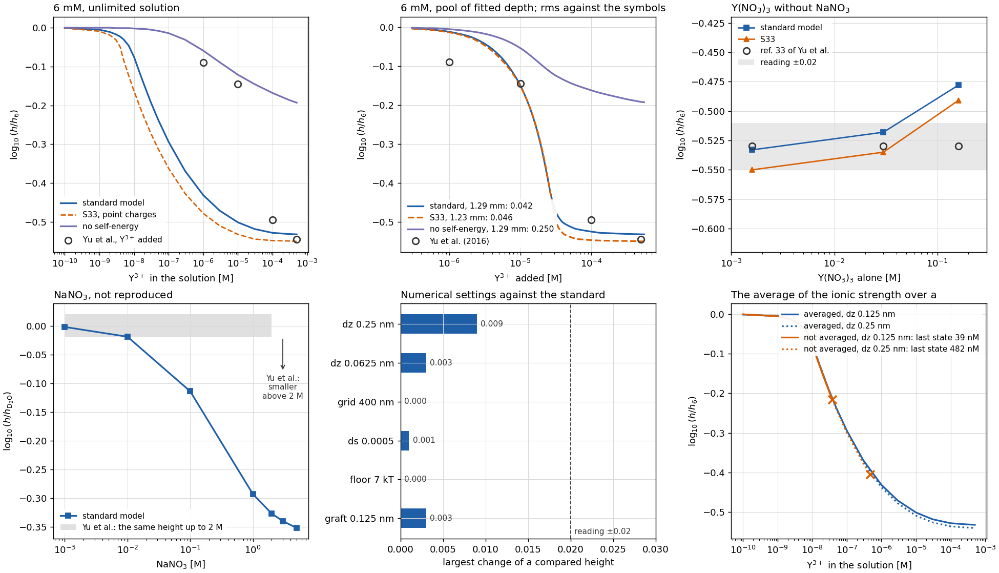

# The standard model of the brush with multivalent ions

[standard_brush.py](../standard_brush.py) holds the standard model of this folder, and [BrushYuExperiment1D.py](../BrushYuExperiment1D.py) solves it in the solutions of the neutron reflectivity experiment of Yu et al., Macromolecules 49, 5609 (2016): a polystyrene sulfonate brush in $`{\rm NaNO_3}`$ and $`{\rm Y(NO_3)_3}`$. It is the smallest model found that reproduces their $`{\rm Y}^{3+}`$ titration. An element stays only when the titration needs it or when leaving it out would break the one free energy of the model, and each has a check below. The model does not reproduce the response to $`{\rm NaNO_3}`$, see [what the model does not reproduce](#what-the-model-does-not-reproduce).

The equations are those of [the theory](ElectrostaticCorrelations.md) with the local self-energy N12, in the solution of the experiment. [The validation of the brush with multivalent ions](MultivalentBrush.md) compares Figs. 2–4 of the paper with `multivalent_brush.py`, which solves the equations of the paper.

## The model

| Element | In the model | Why | Check |
|---|---|---|---|
| Chains | Gaussian chains grafted at the wall, continuous with `cn-adi2`, $`N=100`$, $`\sigma=0.1`$ nm⁻², $`b=1`$ nm, one negative charge per segment | The brush. $`N=100`$ stands for the $`N\approx730`$ of the experiment, because the profile is a function of $`z/N`$ | From $`N=100`$ to 730, $`\log_{10}(h/h_6)`$ at 1 µM moves by 0.011 and the uptake by at most 0.027 ([check, 6.5](DUAN_SCFT_CHECK.md#65-chain-length-and-the-two-layer-collapse)) |
| Mixing | Flory-Huggins, $`v=1`$ nm³, $`\chi=0.5`$ | Sets how dense the collapsed layer gets | Values of the paper, not fitted |
| Ions | Point $`{\rm Na}^+`$, $`{\rm Y}^{3+}`$ and $`{\rm NO_3}^-`$ in the Poisson-Boltzmann equation, in equilibrium with a neutral solution at the end of a grid of 200 nm | The solution of the experiment: neutral salts at a known concentration | A grid of 400 nm changes no printed height |
| Self-energy | $`z^2u`$ on every charge, segments included: a Gaussian charge of radius $`a=0.25`$ nm in the local ionic strength, screened by charges of the same radius, Eq. N12 | The attraction that collapses the brush | Without it the brush never collapses: rms 0.250 against the titration in the pool of the standard depth, and at best 0.241, in an unlimited solution |
| Average over $`a`$ | The ionic strength in $`u`$, and $`u`$ in each field, averaged over a Gaussian of width $`a`$ | An ion feels the charges within its own size, and the equations stay the stationary point of one free energy | Without it the iteration follows the averaged heights into the collapse and then fails: at a residual of $`10^{-5}`$ its last state is at 39 nM of $`{\rm Y}^{3+}`$ with $`dz=0.125`$ nm, where 44 nM fails, and at 482 nM with 0.25 nm. The local form is unstable at short periods ([theory, 11.1](ElectrostaticCorrelations.md#111-response-of-the-self-energy-at-finite-wave-number)), so the result follows the grid |
| Pool | What is added is shared between a pool of depth $`D`$ and the brush: $`\rho_{\rm added}=\rho_b+f(\rho_b)\,\sigma N/(3D)`$, with the 73 charges per nm² of the brush of the experiment and $`f`$ the uptake per chain charge | The trough of the experiment holds a finite amount of solution, and the brush can take up 24 $`{\rm Y}^{3+}`$ per nm², where 1 mm of 10 µM holds 6 | In an unlimited solution, rms 0.247; in a pool of fitted depth, 0.042 |
| Height | $`h=2\langle z\rangle`$ | | The outer edge of the film in its place closes no gap ([check, 6.6](DUAN_SCFT_CHECK.md#66-closed-cell)) |

The depth $`D`$ is the one fitted number. Every other value is that of the paper or of the experiment.

## Against the experiment



**$`{\rm Y}^{3+}`$ titration at ionic strength 6 mM** (top left and middle). Heights are relative to 6 mM $`{\rm NaNO_3}`$, as in the experiment. In an unlimited solution the height halves at 110 nM, two to three decades before the experiment collapses, between 10 and 100 µM. In a pool 1.29 mm deep the model follows the four symbols at rms 0.042, against readings of about ±0.02; depths from 0.79 to 1.78 mm stay within 0.01 of that. At 1 and 10 µM added the pool then keeps only 2 and 20 nM, because the brush holds the rest. Over the 3 inch wafer, 1.29 mm is about 6 mL.

| $`{\rm Y}^{3+}`$ added [M] | Yu et al. | Model, pool 1.29 mm | $`{\rm Y}^{3+}`$ left in the pool [M] | Without the self-energy |
|---|---|---|---|---|
| $`10^{-6}`$ | −0.09 | −0.012 | $`2.2\times10^{-9}`$ | −0.005 |
| $`10^{-5}`$ | −0.145 | −0.151 | $`2.0\times10^{-8}`$ | −0.055 |
| $`10^{-4}`$ | −0.495 | −0.525 | $`7.0\times10^{-5}`$ | −0.163 |
| $`5\times10^{-4}`$ | −0.545 | −0.532 | $`4.7\times10^{-4}`$ | −0.193 |

One depth does not fit each symbol alone: they ask for 8.0, 1.25 and 0.40 mm, and the last symbol lies 0.013 below the deepest height of the model.

**$`{\rm Y(NO_3)_3}`$ alone** (top right), the symbols of ref. 33 of Yu et al., relative to 6 mM $`{\rm NaNO_3}`$. At 1.6 and 30 mM the model gives −0.533 and −0.518 against −0.53. At 160 mM it swells back to −0.478, where the experiment stays at −0.53.

**$`{\rm NaNO_3}`$** (bottom left). Yu et al. measure the same height up to 2 M and a smaller one above. The model shrinks from 0.1 M: −0.114 at 0.1 M, −0.293 at 1 M and −0.327 at 2 M, relative to $`{\rm D_2O}`$. The model needs a salt in the pool, so $`{\rm D_2O}`$ is taken as 0.09 mM $`{\rm NaNO_3}`$, the charge of the brush spread over the pool; 1 mM moves the height by 0.002.

## Left out, and why

**The box of the paper.** The calculation of Fig. 2 of the paper holds the monovalent counterions of the chains in a box of length $`L`$, so that the box, not a salt, sets the monovalent density outside the brush ([the validation of the paper's model](MultivalentBrush.md#what-differs-from-fig-2-and-why)). The experiment has 3–6 mM $`{\rm Na}^+`$ from $`{\rm NaNO_3}`$, and the counterions the brush releases add about 0.1 mM to the pool. The model therefore takes the neutral solution with its pool, and $`L`$ is gone.

**Terms of the paper that the titration does not need.**

| Term | Why it is left out |
|---|---|
| Long-range part $`G_l`$ of the Green function | Along the titration it changes $`\log_{10}(h/h_6)`$ by at most 0.004 and the uptake by at most 0.008, with the form of the paper on a grid of 0.1 nm over 120 nm. It moves the readings of Fig. 2 that do not depend on $`L`$ by at most 0.005 ([the validation of the paper's model, part 3](MultivalentBrush.md#part-3-fig-4cd-the-green-function-in-the-varying-ionic-strength)) |
| $`u_P^{\rm ex}`$ and $`I_{ex}`$ | The paper drops $`u_P^{\rm ex}`$. $`I_{ex}`$ is its derivative with respect to $`G`$, so the two go together and the equations stay the stationary point of one grand potential |
| $`\ln\langle Q_l\rangle`$ of S29–S32 | It enters only $`u_P^{\rm ex}`$ and $`I_{ex}`$ |
| The derivative of $`\epsilon`$ with the composition in S27 | The model and the paper use a uniform $`\epsilon`$ |
| Volumes of the ions, through $`\xi`$ | The model and the paper use $`v_C=v_\pm=0`$ |
| Screening by point charges, S33 | The paper screens the self-energy with point charges. That form is not the stationary point of the free energy of the theory, and keeping the charge spread gives N12. The titration does not decide between them: S33 fits a pool 1.23 mm deep at rms 0.046, against 0.042, and gives −0.550, −0.535 and −0.491 for $`{\rm Y(NO_3)_3}`$ alone |

**Every charge feels the self-energy.** A charge that screens but does not feel $`u`$ has no term in the grand potential that gives its field, so taking $`u`$ from the segments or from the monovalent ions breaks the free energy. With the form of the paper it also moves Fig. 2 by up to 0.12, and in the pool of the experiment it gives rms 0.045 to 0.070 at the same depth ([the validation of the paper's model](MultivalentBrush.md#what-the-model-leaves-out)).

**Corrections tried.** Each writes the correlations as a one-loop free energy at the local composition, so that every self-energy stays a derivative of it.

- **Screening by charges of the ion radius: kept.** N12 is the one-loop form for free segments and costs no more than S33.
- **A compressible solvent: left out.** The segments screen through the structure factor of segments in a solvent with the compressibility of water, $`\zeta=v/(\kappa_TkT)=540`$ per segment volume, from $`\kappa_T=4.5\times10^{-10}`$ Pa⁻¹ and $`v=1`$ nm³, so $`\zeta N=5.4\times10^4`$. In the collapsed layer, at $`\phi=0.7`$ and 0.23 $`{\rm Y}^{3+}`$ per nm³, the response at $`k\to0`$ is already that of an incompressible layer: $`S/\rho_P=0.381`$, against the limit 0.380. $`u`$ of the ions is 3.6 % weaker than with free segments and changes by less than 1 % from water to the incompressible limit. The self-energy of the segments does not converge:

| $`\zeta N`$ | $`10^2`$ | $`10^4`$ | $`5.4\times10^4`$, water | $`10^7`$ | $`10^{10}`$ | Free segments |
|---|---|---|---|---|---|---|
| $`u_P`$ [$`kT`$] | −0.86 | −1.16 | −1.27 | −1.48 | −1.59 | −0.81 |

A stiffer solvent suppresses the density fluctuations up to a wave number that the shape given to a segment sets, and that wave number grows as $`\sqrt{\ln\zeta}`$ into the range that a charge of radius $`a`$ still feels. $`u_P`$ then depends on a shape the model does not fix, so the model keeps free segments.

- **Segments that screen as a chain: left out.** The segments screen through the form factor of a Gaussian chain of $`N`$ segments tethered at one end, which vanishes at $`k=0`$ and is one at large $`k`$. Continued from free segments in the compressible solvent above, the brush shrinks, and the iteration finds no state beyond 0.25 of the way to the chain salt-free and beyond 0.35 in 6 mM $`{\rm NaNO_3}`$. Whether the state is lost or only the iteration fails was not settled. In a uniform salt-free layer at $`\phi=0.1`$ the chain makes $`u_P=-6.1`$ $`kT`$ per segment, against −0.42 for free segments: about 600 $`kT`$ per chain, far outside the range of the first-cumulant closure ([check, section 8](DUAN_SCFT_CHECK.md#8-neglected-terms-and-range-of-validity)). Connectivity needs the correlations taken with the conformation of the chain, beyond this closure.

## Numerical settings

$`dz=0.125`$ nm over 200 nm, $`ds=0.001`$, a floor of the field 6 $`kT`$ per segment below its largest value, a Gaussian graft of width 0.5 nm at the absorbing wall, and a residual below $`10^{-7}`$. The bottom middle panel above gives the largest change of any compared height, the four symbols in the pool of 1.29 mm, $`{\rm Y(NO_3)_3}`$ alone and $`{\rm NaNO_3}`$, when one setting changes: 0.009 for $`dz=0.25`$ nm and 0.003 for 0.0625 nm, 0.003 for a graft of width 0.125 nm, 0.001 for $`ds=0.0005`$, and less than 0.0005 for a grid of 400 nm or a floor of 7 $`kT`$. Each stays below the reading uncertainty, and the fitted depth moves by at most 0.01 mm.

## What the model does not reproduce

- **$`{\rm NaNO_3}`$ up to 2 M.** The likely missing element is the finite length of the chains. 25 mg/m² is 73 monomers per nm², so at the estimated $`\sigma\approx0.1`$ nm⁻² a chain of 730 monomers of 0.25 nm is 183 nm long, shorter than the measured 250–300 nm; the grafting density must be lower, and the chains stretched close to their full length. Such chains keep their height while salt lowers the osmotic pressure, and Gaussian chains, which have no length limit, cannot. `polymerfts` has no chain model with a finite length.
- **$`{\rm Y(NO_3)_3}`$ at 160 mM**, where the model swells back by 0.052.
- **One depth for all four symbols**, and the depth itself: Yu et al. give no depth or volume of the trough, and whether the solution was replaced at each step. Measuring the depth, or the titration at two depths, would test the pool.
- **The profile.** Yu et al. fit a Gaussian-like collapsed film with its peak near the middle and point to pinned micelles, a lateral structure. The model gives a dense layer against the wall.
- **Divalent ions.** At 33 mM the brush is collapsed in $`{\rm Ba}^{2+}`$ and swollen in $`{\rm Mg}^{2+}`$. The model treats both alike; Yu et al. attribute the difference to ion binding.

## Checks and limits

- Checked (validation runs): the code against `multivalent_brush.py`. With `spread=True` on the same grid of 0.25 nm, that code gives the same titration and the same uptake to all printed digits.
- Checked (validation runs): each element and setting above, by the runs in the table and the panels.
- Not checked: the self-energy against an exact result at this coupling, where $`\kappa a\approx1.3`$ in the collapsed layer and the first-cumulant closure is not controlled; the depth of the trough; $`N=730`$ with N12, taken from the form of the paper.

Run from this folder, about five minutes on one CPU core:

```bash
python BrushYuExperiment1D.py
```
