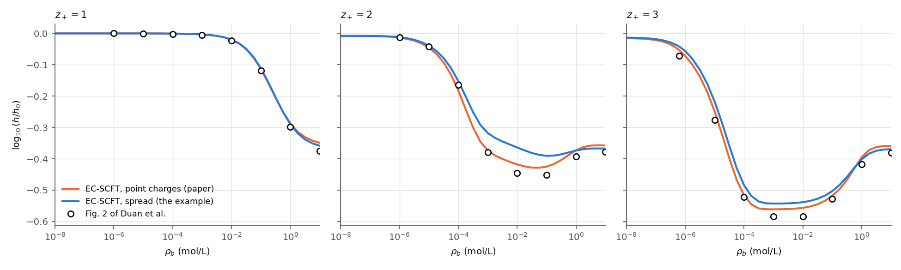
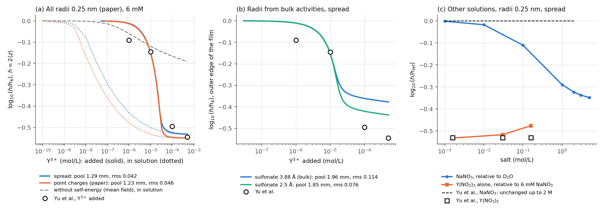
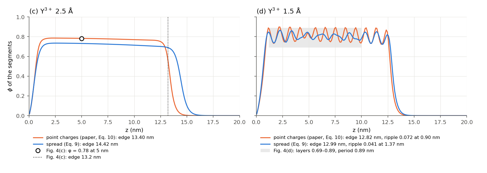

# Validation of the Brush with Multivalent Ions

What the validation runs check for [BrushMultivalentIons.py](../../examples/charged/ecscft/BrushMultivalentIons.py) and for the equations of [EC-SCFT](../theory/ElectrostaticCorrelations.md): a polyelectrolyte brush that trivalent counterions collapse, with the self-energy of every charge. The labels are those of [Validation of the Examples](ExampleValidation.md).

The runs take the brush of Duan, Agrawal and Wang (Reference 1): $`N=100`$ segments of $`b=1`$ nm and $`v=1`$ nm³ grafted at 0.1 nm⁻², $`\chi=0.5`$, $`\ell_B=0.7`$ nm, one negative charge per segment, discrete chains with one bead per segment (`rs`) as in the paper. They use the code of the example with its radii, $`b`$ and $`v`$ changed, on its grid ($`\Delta z=0.125`$ nm over 200 nm). Fig. 2 of Reference 1 needs counterions conserved in a closed box, which the example does not have; for it the runs use an independent implementation of the same equations, which agrees with the example within $`3\times10^{-7}`$ in the solution of the experiment. "Spread" is the screening of the example (Eq. (11) of the theory) with the mean potential averaged over each charge (Eqs. (20) and (21)); "point" is that of the paper (Eq. (14)), the limit of point screening charges taken by Wang (Reference 2), with the mean potential at the centre of each charge.

## Checks

- Checked (validation runs): the self-energy. The quadrature of Eq. (11) agrees with the closed form Eq. (14) within 10⁻⁷ when the screening charges have no spread, and with a table of Eq. (13) within 4×10⁻⁷ for one radius. With all radii 0.25 nm the example and an independent implementation agree within $`3\times10^{-7}`$ in $`\log_{10}(h/h_6)`$ in all 14 states of the solution of the experiment, with either screening.
- Checked (validation runs): the grid. From $`\Delta z=0.25`$ to 0.125 and 0.0625 nm, $`\log_{10}(h/h_6)`$ changes by less than $`10^{-4}`$ and $`h_6`$ by less than 0.005 % ([Grid](#grid)): `rs` sums the bonds of the discrete chains on the grid, with no contour step to converge.
- Checked (validation runs): Fig. 2 of Reference 1 with the published screening. With a box length $`L=6.6`$ µm, which the paper does not state and which is fitted, the point form follows all 24 readings for $`z_+=1`$, 2 and 3 at rms 0.017 (largest 0.028). At high salt, where $`L`$ does not enter, it lies about 0.02 above the readings for every valence, the same on grids of 0.25 and 0.125 nm; continuous chains in place of the discrete ones of the paper lower it by 0.003, so neither the grid nor the chain model explains the offset. The spread form, at the same $`L`$, lies at rms 0.033 (largest 0.082), and a box length fitted to it alone (near 9 µm) lowers this only to 0.028: the paper computes with point charges ([Fig. 2 of Duan et al.](#fig-2-of-duan-et-al)).
- Checked (validation runs): the titration of Yu et al. (Reference 4) with the radius 0.25 nm of the paper for all charges. In an unlimited solution the brush falls to about half its height ($`\log_{10}(h/h_6)=-0.27`$) at 74 nM of Y³⁺ (30 nM with point screening), two to three decades before the experiment. If the Y³⁺ added is shared between the brush and a pool of solution of fitted depth, the model follows the four measured heights at rms 0.042 (pool 1.29 mm; point screening 0.046 with 1.23 mm). Without the self-energy (mean field) the brush shrinks only to −0.19 at 500 µM, and no pool depth brings it to the experiment (rms 0.24) ([The experiment of Yu et al.](#the-experiment-of-yu-et-al)).
- Not reproduced: the titration with Born radii from bulk activity coefficients. Fitted with the self-energy of the example, the radii are 3.34 Å for Na⁺ and NO₃⁻, 3.88 Å for the sulfonate and 5.93 Å for Y³⁺. With them, and the monomer volume and statistical length of the experiment, the collapse at the outer edge of the film stops at −0.38 at 500 µM, and at −0.44 with segment charges of 2.5 Å, against the measured −0.545.
- Not reproduced: Y(NO₃)₃ alone at 160 mM, where the model swells back to −0.48 and the experiment stays at −0.53 (at 1.6 and 30 mM the model gives −0.53 and −0.52); and NaNO₃, which leaves the measured height unchanged up to 2 M and shrinks the model from 0.1 M (−0.11 at 0.1 M, −0.32 at 2 M).
- Not reproduced (validation runs with the published screening and continuous chains): Fig. 3 of Reference 1. It plots Eqs. 7 and 9 of the paper, an expansion about the bulk that needs a salt concentration much larger than the charge of the brush. The brush of Fig. 2 holds the charge of the figure only from 3 M (at $`z_+=3`$ and 10 M, $`\Gamma=0.136`$ against 0.134 read); below, it holds much less (the lowest $`\Gamma`$ is −0.61 against −1.31).
- Checked (validation runs with the Green function of either screening): Fig. 4(c,d) of Reference 1, a brush in 1 mM 3:1 salt with the self-energy from the Green function solved in the varying ionic strength. With point screening the runs reproduce the figure: the flat layer of (c) at φ = 0.78 (paper 0.78) with its edge at 13.4 nm (13.2), and at a Y³⁺ radius of 1.5 Å the layers of (d) with period 0.90 nm (0.89) and φ = 0.73–0.90 (0.69–0.89). With spread screening the layer of (c) is less dense (0.73) and thicker (edge 14.4 nm), and the layers of (d) remain, weaker (amplitude 0.041 against 0.072) and less regular, with spacings of 1.0 to 1.5 nm. The linear stability of the uniform layer agrees: it turns unstable below a Y³⁺ radius of 1.83 Å with point screening and of 1.64 Å with spread screening ([Fig. 4 of Duan et al.](#fig-4-of-duan-et-al)). The local form of the example has no response at finite wave number and gives no layers.
- Not reproduced (validation runs with the published screening, the local form and continuous chains): Fig. 4(a,b), the lateral structure of a brush at 0.03 chains/nm². The hexagonal pattern holds once seeded, but lies above the planar layer at every spacing tried, and ridges lie below it.
- Not checked: the brush against complex Langevin simulations of the same model; the closure itself at the coupling of the collapsed brush.

## Fig. 2 of Duan et al.

Monovalent counterions are conserved in a box of length $`L=6.6`$ µm, a $`z_+`$:1 salt comes from a reservoir at $`\rho_b`$, no field crosses the far end, and every charge has the radius 0.25 nm. The height is $`h=2\langle z\rangle`$: the paper reads it from a Gibbs dividing surface that it does not define, and a thesis from the same group defines that surface as $`2\int z\phi\,dz/\int\phi\,dz`$ (Reference 5, Eq. 4.1), the same height. The reference $`h_0`$ is the salt-free brush. The paper does not state $`L`$; the onset of the collapse moves with it as $`L^{-2z_+/(z_++1)}`$, so the low-salt half of the figure depends on this fitted value. The high-salt half does not: at $`z_+=2`$ and 0.1 M the paper reads −0.451, the point form gives −0.425 and the spread form −0.391.

## The experiment of Yu et al.

Yu et al. measured the height of a polystyrene sulfonate brush by neutron reflectivity in Na⁺, Y³⁺ and NO₃⁻ at a fixed ionic strength of 6 mM, relative to 6 mM NaNO₃. The ions of the model come from a solution of these concentrations at the far end of the grid. The trough of the experiment holds a finite amount of solution, and the brush can take up more Y³⁺ than it contains at 1 and 10 µM: the Y³⁺ added is shared between the brush (73 charges per nm², from the 25 mg/m² of the experiment) and a pool of depth $`D`$, the one fitted number.

(a) All radii 0.25 nm, as in the paper, $`h=2\langle z\rangle`$. Dotted lines are the heights against the Y³⁺ in solution, solid lines against the Y³⁺ added to the pool.

(b) Radii fitted to bulk mean activity coefficients at 25 °C with the self-energy of the example: NaNO₃ at 0.1 mol/kg ($`\gamma_\pm=0.760`$, Hamer and Wu, Reference 3) for Na⁺ and NO₃⁻, Na p-toluenesulfonate at 0.1 mol/kg (0.764) for the sulfonate with Na⁺ fixed, and Y(NO₃)₃ up to 0.1 mol/kg (Rard and Spedding, Reference 3) for Y³⁺ with NO₃⁻ fixed. The point form gives larger radii from the same data:

| Ion | Spread (the example) | Point (the paper) |
|---|---|---|
| Na⁺, NO₃⁻ | 3.34 Å | 4.48 Å |
| Sulfonate | 3.88 Å | 5.20 Å |
| Y³⁺ | 5.93 Å | 7.47 Å |

The Y³⁺ radius of the example, 6.6 Å, fits the same Y(NO₃)₃ data with the point form and one radius for Y³⁺ and NO₃⁻.

The brush takes the monomer volume of the dry film ($`v=0.34`$ nm³, 25 nm thick with 73 monomers per nm²) and the statistical length of polystyrene ($`b=0.68`$ nm), and the height is read at the outer edge of the film, where the polymer volume fraction falls to 0.033 (a scattering length density of 6.2×10⁻⁶ Å⁻² between D₂O and the polymer). The collapse stops at −0.38 with the bulk radius of the sulfonate and at −0.44 with 2.5 Å (rms 0.114 and 0.076 against the four points); with $`h=2\langle z\rangle`$ the same states give −0.44 and −0.49.

(c) The radius of the paper in other solutions: Y(NO₃)₃ alone relative to 6 mM NaNO₃, and NaNO₃ relative to D₂O, taken as 0.09 mM NaNO₃ (the charge of the brush spread over the pool).

## Fig. 4 of Duan et al.

0.1 chains/nm², $`z_+=3`$ at $`\rho_b=1`$ mM, counterions conserved as in Fig. 2, every other charge of radius 0.25 nm. The self-energy comes from the Green function of Eq. (10) (point) or Eq. (9) (spread) of the theory, solved along $`z`$ for 36 wave numbers along the wall on 40 nm with $`\Delta z=0.1`$ nm, with the medium of the first and the last cell continued 5 nm beyond the wall and the far end so that neither holds an image charge; in a uniform medium it agrees with Eqs. (14) and (11) within 0.8 %. The spread operator is banded, and the band of its inverse that the self-energy needs comes exactly from a selected inversion (Takahashi recursion on the Cholesky factor). The runs leave out the intrachain term, as the paper does. The layers grow from a small wave in damped steps; the layered states settle slowly and stop at residuals of $`10^{-3}`$ (point) and $`9\times10^{-4}`$ (spread, after 26,000 steps; after 9,000 its layers were still 0.8 nm apart), and they are not unique: with continuous chains another start of the point form gave a period of 0.94 nm. The flat layers converge to $`10^{-6}`$.

The linear stability uses the first-order response of the self-energy of each screening in a uniform medium with the composition of the middle of the layer of (d) ($`\phi=0.8`$, $`\kappa=5.3`$ nm⁻¹), the response of the discrete chain and, with spread screening, the Coulomb interaction of the spread charges: the smallest eigenvalue of the stability matrix at a Y³⁺ radius of 1.5 Å is −1.48 at a period of 1.02 nm with point screening and −0.55 at 1.05 nm with spread screening; at 2.5 Å it is +2.02 and +2.12.

## Grid

$`\log_{10}(h/h_6)`$ of the example (spread, radii of the example) and with all radii 0.25 nm, at 1, 10, 100 and 500 µM Y³⁺:

| $`\Delta z`$ | Radii of the example | All radii 0.25 nm |
|---|---|---|
| 0.25 nm | −0.140, −0.219, −0.268, −0.290 | −0.431, −0.501, −0.528, −0.532 |
| 0.125 nm (the example) | −0.140, −0.219, −0.268, −0.290 | −0.431, −0.501, −0.528, −0.532 |
| 0.0625 nm | −0.140, −0.219, −0.268, −0.290 | −0.431, −0.501, −0.528, −0.532 |

The values agree to the last digit on the three grids, and $`h_6`$ changes by 0.002 nm. The example takes about one minute on one CPU core.

## References

1. C. Duan, N. R. Agrawal and R. Wang, Electrostatic Correlation Augmented Self-Consistent Field Theory and Its Application to Polyelectrolyte Brushes, *Phys. Rev. Lett.* **2025**, 134, 048101.
2. Z.-G. Wang, Fluctuation in electrolyte solutions: The self energy, *Phys. Rev. E* **2010**, 81, 021501.
3. W. J. Hamer and Y.-C. Wu, Osmotic Coefficients and Mean Activity Coefficients of Uni-univalent Electrolytes in Water at 25 °C, *J. Phys. Chem. Ref. Data* **1972**, 1, 1047; J. A. Rard and F. H. Spedding, Isopiestic Determination of the Activity Coefficients of Some Aqueous Rare-Earth Electrolyte Solutions at 25 °C. 6. Eu(NO₃)₃, Y(NO₃)₃, and YCl₃, *J. Chem. Eng. Data* **1982**, 27, 454.
4. J. Yu, J. Mao, G. Yuan, S. Satija, Z. Jiang, W. Chen and M. Tirrell, Structure of Polyelectrolyte Brushes in the Presence of Multivalent Counterions, *Macromolecules* **2016**, 49, 5609.
5. T. Yokokura, Ph.D. thesis, University of California, Berkeley, 2025.
