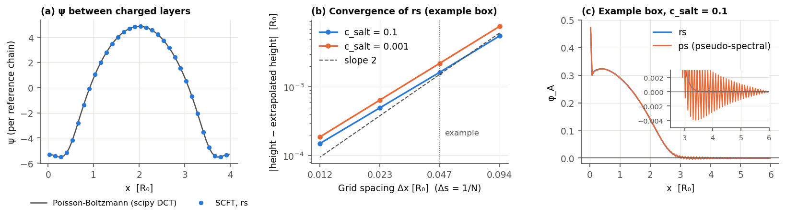

# Validation of the Examples

What the tests and validation runs check for the examples under [`examples/`](../../examples/README.md), with the compared numbers and figures, and what has not been checked. `TestExamples` builds every example (inputs, input checks and construction) but does not run it. [Numerical Validation](NumericalValidation.md#comparison-with-published-results-and-other-codes) lists the papers and codes that polymerfts reproduces, and its section [Differences and limits](NumericalValidation.md#differences-and-limits) collects the differences from published results and their causes. The full references of the papers are listed in the [examples index](../../examples/README.md#references).

Each example lists under these labels:
- **Checked**: what a test or a validation run compared with a reference, and the result.
- **Not checked**: what has not been compared with a reference.
- **Not reproduced**: what was compared but differs from the reference.
- **Not reproducible**: what needs a model feature that the code does not have.
- **Limits found**: limits of the method that the comparisons showed.

## Summary

| Example | Compared with | Result |
|---|---|---|
| [`block_copolymer/clfts/SoftBeadDiblockMelt.py`](SoftBeadModels.md) | CL-FTS of Lequieu 2024; exact Monte Carlo of a Gaussian-core fluid | Agrees: chemical potentials within 0.003–0.02 kT, pressures within about one standard error; the excess pressure of the polyampholyte lies 2 % of its fluctuation correction below (not confirmed) |
| `blend/scft/MixtureBlockRandom.py`, `blend/lfts/MixtureBlockRandom.py` | Flory-Huggins (homogeneous states) | Checked; the ordered blend not checked |
| `blend/scft/CanonicalCoexistence.py` | Common tangent of the Flory-Huggins free energy | Checked |
| [`blend/clfts/GibbsEnsemble.py`](BlendGibbsEnsemble.md) | Flory-Huggins binodal; canonical CL-FTS at N̄ = 10⁴; Fredrickson and Delaney 2023, Fig. 7.2 | Agrees: 0.92928 in the mean-field limit, 0.91498 ± 0.00009 against 0.91497 ± 0.00013 at N̄ = 10⁴. Fig. 7.2: 11 of 13 points within about one error; one is 2.3 errors off, and at the last the run reaches one phase (undecided) |
| `blend/clfts/HomopolymerSolutionBook.py` | Fredrickson and Delaney 2023 | Agrees within the reading precision (0.1–0.2 %) |
| `charged/scft/ChargedDiblockLamella.py` | Strong-screening limit, grid convergence | Checked; the unscreened lamellae not compared |
| `charged/scft/SaltDopedLamella.py` | Locally neutral limit (a neutral salt molecule), grid convergence | Checked; published salt-doped lamellae not compared |
| `charged/scft/PolyelectrolyteBrush.py` | Independent Poisson-Boltzmann solution, Δx and Δs convergence | Checked; brush theory not compared |
| [`charged/scft/multivalent_brush/BrushMultivalentIons1D.py`](MultivalentBrush.md) | Duan et al. 2025 Fig. 2; Yu et al. 2016 Fig. 7 | Fig. 2 agrees with its box length fitted (rms 0.011); the experiment agrees only with a fitted solution depth (rms 0.049) |
| [`charged/scft/multivalent_brush/BrushMultivalentIonsGreen1D.py`](MultivalentBrush.md) | Duan et al. 2025 Fig. 4(c,d) and Fig. 2 | The flat and the oscillatory layer agree (period 0.87 nm, read 0.89); the deep collapse of Fig. 2 moves slightly closer (rms 0.010 from 0.012, 11 readings) |
| [`charged/scft/multivalent_brush/BrushMultivalentIonsLateral.py`](MultivalentBrush.md) | Duan et al. 2025 Fig. 4(a,b) | The pattern of caps on a hexagon forms and holds, but it is not the lowest state of this model |
| [`charged/scft/CounterionsBetweenPlates.py`](Electrolytes.md) | Poisson-Boltzmann of Netz 2001 | Agrees: profile within 10⁻³, pressure within 3×10⁻⁵ |
| [`charged/clfts/CounterionsBetweenPlates.py`](Electrolytes.md) | Netz's loop expansion, exact lattice Monte Carlo | Agrees up to Ξ ≈ 0.6; wrong at Ξ ≥ 0.85 (limit of CL-FTS) |
| [`charged/clfts/SmearedSaltSelfEnergy.py`](Electrolytes.md) | One-loop theory, exact Monte Carlo | Agrees: 0.1 % at weak coupling, Monte Carlo up to l_Bκ = 4.8 |
| `charged/clfts/ChargedDiblock.py` | RPA at N̄ = 10⁶ | Checked at weak fluctuations; the example's regime not checked |
| `charged/clfts/SaltReservoir.py` | Donnan equilibrium, one-loop theory | Agrees: the one-loop theory predicts the shift of the ions to 0.5 % |
| [`charged/clfts/ComplexCoacervate.py`](ComplexCoacervate.md) | Lee et al. 2008; Danielsen et al. 2019 | Structure factors agree; the phase diagram of Lee's Fig. 6 not reproduced (explained); Danielsen's converged binodal lies 3.4–5 % below the paper; with the paper's contour step the gap closes at E = 4000 and shrinks to 2 % at E = 2000 (explained) |
| [`charged/clfts/CoacervateGibbs.py`](CoacervateGibbs.md) | One-loop theory; canonical CL-FTS and its Maxwell construction | Agrees far from the critical point: within 0.0005 of one-loop theory and of canonical runs, independent of `exchange_rate`, `cycle_steps` and the volumes. Near it single runs scatter by ±0.005 around the Maxwell construction |
| `charged/clfts/PolyampholyteSolution.py` | McCarty et al. 2019 | Chemical potentials, pressures and the binodal agree; the density structure function lies 3–8 % below (undecided); two state points inside the two-phase region differ (explained) |

The sections below give the details, and the longest entries have a page of their own.

## Block copolymers

Paths are relative to `examples/block_copolymer/`.

- **`clfts/SoftBeadDiblockMelt.py`** (Lequieu 2024): [SoftBeadModels.md](SoftBeadModels.md)

## Blends and coexistence

Paths are relative to `examples/blend/`.

- **`scft/MixtureBlockRandom.py`, `lfts/MixtureBlockRandom.py`**
  - Checked: the random copolymer in the homogeneous SCFT thermodynamics, against Flory-Huggins (`TestPhaseEquilibrium`).
  - Not checked: the ordered blend against a reference.
- **`scft/CanonicalCoexistence.py`**
  - Checked (`TestPhaseEquilibrium`): the coexistence solver against the common tangent of the Flory-Huggins free energy; homogeneous SCFT states against Flory-Huggins within 10⁻¹²; the exchange chemical potential of a modulated diblock/homopolymer blend against dF/dφ. The binodal of this example is therefore the Flory-Huggins binodal.
  - Not checked: a binodal with a modulated phase against an independent calculation.
- **`clfts/GibbsEnsemble.py`**: [BlendGibbsEnsemble.md](BlendGibbsEnsemble.md)

- **`clfts/HomopolymerSolutionBook.py`** (Fredrickson and Delaney 2023, Figs. 5.6, 5.7, 5.8 and 7.14)
  - Checked (validation runs, ETD integrator): the excess chemical potential and pressure of a homopolymer in implicit good solvent (continuous chains, B = C = 1, a = Δx = 0.1 R_g; the Edwards model maps onto the compressible model with ζN = BC), and the excess chemical potential of a disordered diblock melt (χN = 10, f = 0.34, C = 20, ζN = 100, a = 0.2 R_g, 48³ points), against the book's figures:

| System | Quantity | polymerfts | Fredrickson and Delaney |
|--------|----------|-----------:|------------------------:|
| Homopolymer solution, L = 1.6 R_g (16³) | βμ_ex / βP_ex R_g³ | 1.2905 ± 0.0011 / 0.45703 ± 0.00026 | 1.292 ± 0.002 / 0.4571 ± 0.001 |
| Homopolymer solution, L = 3.2 R_g (32³) | βμ_ex / βP_ex R_g³ | 1.3291 ± 0.0005 / 0.47727 ± 0.00027 | 1.330 ± 0.002 / 0.4773 ± 0.001 |
| Homopolymer solution, L = 6.4 R_g (64³) | βμ_ex / βP_ex R_g³ | 1.3350 ± 0.0008 / 0.48311 ± 0.00039 | 1.335 ± 0.002 / 0.4831 ± 0.001 |
| Disordered diblock melt | βμ_ex | 4.5948 ± 0.0002 | 4.5949 ± 0.0003 |

  The book's values are read from its figures, with errors that include the reading. The time step changes nothing within the errors (δτN = 0.5 and 2 at L = 1.6 R_g; 1 and 2 for the diblock). The recorded pressure is the virial form of the operator. The dilation of the box at fixed grid values has the same average, but its Gaussian terms, which cancel on average, raise the standard deviation per sample from 0.013 to 10.3 at L = 1.6 R_g (0.497 ± 0.096 at L = 3.2 R_g in the same run) ([CL-FTS theory, Section 7](../theory/ComplexLangevinSimulation.md#7-chemical-potential-and-osmotic-pressure)). The diblock run starts at the homogeneous saddle point, since the uniform mode of the pressure field relaxes slowly from zero.
  - The example `HomopolymerSolutionBook.py` (L = 3.2 R_g, 20000 steps, 11 min on an A10 GPU) gives βμ_ex = 1.3274 ± 0.0006 and βP_ex R_g³ = 0.4768 ± 0.0002.
  - Not checked: the book's discrete-chain homopolymer (Fig. 5.11, whose two quoted values disagree), the coacervate surface tension (Fig. 7.11, parameters not given) and its free energies (Figs. 7.8–7.10, which need thermodynamic integration).

## Charged systems

Paths are relative to `examples/charged/`. SCFT solves a deterministic mean-field problem. CL-FTS adds the question whether complex Langevin sampling converges to the correct averages, which has been checked for charged systems only where the fluctuations are weak ([CL-FTS theory, Section 6](../theory/ComplexLangevinSimulation.md#6-charged-systems), "Checked range").

- **`scft/ChargedDiblockLamella.py`**
  - Checked (`TestScftElectrostatics`, mostly with essentially the system of this example: charged AB diblock with Na⁺ Cl⁻ point ions, discrete chains, N = 50, E = 2000): zero valences reproduce neutral SCFT; the stress equals dF/dL with canonical and with grand-canonical ions; the Donnan potential of homogeneous states; canonical and grand-canonical ions reach the same state; the platforms agree. With the oppositely charged blocks and continuous chains described below: under strong screening the free energy and the relaxed period approach those of the neutral diblock with χ_eff N within 10⁻⁵.
  - Checked (validation runs): the strong-screening limit below, and the convergence of the periods that the example prints in the grid. With 64, 128 and 256 grid points they agree to seven digits: 4.35597, 4.38527, 4.43950, 4.58712 and 4.78701 R₀ for c_salt = 0, 0.01, 0.03, 0.1 and 0.3, and 4.97436 R₀ for the neutral diblock. The contour step is fixed by the discrete chains (N = 50).
  - Not checked: the periods and free energies of the unscreened lamellae against another code or published results.

Strong screening: blocks with valences +0.5 and −0.5, continuous chains (Δs = 1/50), 64 grid points, χN = 25 and E = 10/λ² for screening lengths λ = 1/κ = 0.02 to 0.005 R₀. The Coulomb term then acts as the contact interaction −E (z_A − z_B)²/(2κ²) = −5, and the free energy and the relaxed period approach those of the neutral diblock at χ_eff N = 20 linearly in λ² (the ratio of the differences at λ = 0.01 and 0.005 is 3.99).

- **`scft/SaltDopedLamella.py`**
  - Checked (validation runs, tolerance 10⁻⁹): (a) the strong-coupling limit, at φ_s = 0.02 with 256 and 512 grid points. When the Debye length is much shorter than the domains, the cation and the anion have the same concentration everywhere, and the salt acts as one neutral molecule of one segment with the volume fraction 2φ_s and χN = (χ_AP N + χ_AM N)/2 = 62.5. As E doubles from 10⁵ to 6.4×10⁶ (Debye length 0.11 to 0.014 R₀), the differences of the free energy and of the relaxed period from those of this neutral salt shrink by the factors 1.79, 1.88, 1.93, 1.96, 1.98, 1.99 and 1.56, 1.75, 1.86, 1.92, 1.96, 1.98, so they vanish linearly in 1/E. At E = 6.4×10⁶ they are −2.0×10⁻⁴ and −3.6×10⁻⁴ R₀, the partitions are 2.998 (P) and 2.991 (M) against 2.994 of the neutral salt, and the largest local charge is 6×10⁻⁵. The free energies and periods of the 256- and 512-point runs agree to nine digits. (b) The periods that the example prints (128 points) agree with 64 and 256 points to eight digits: 4.70783, 4.72989, 4.77735 and 4.87378 R₀ for φ_s = 0.005, 0.01, 0.02 and 0.04. (c) At the relaxed period of φ_s = 0.04 (64 points), the central difference of F over L(1 ± h) falls as h²: −2.0×10⁻⁵, −3.2×10⁻⁶ and −7.8×10⁻⁷ for h = 1 %, 0.4 % and 0.2 %. (d) In every run of (b), the mean ion concentrations equal φ_s, and the mean charge vanishes to 10⁻¹⁷.
  - Not checked: the periods and ion partitions against published SCFT of salt-doped block copolymers or another code.

- **`scft/multivalent_brush/`**: [MultivalentBrush.md](MultivalentBrush.md)

- **`scft/PolyelectrolyteBrush.py`**
  - Checked (`TestConfinedElectrostatics`, with discrete chains and pseudo-spectral propagators): ψ in a closed box against an independent Poisson-Boltzmann solution between fixed charge layers (10⁻⁹); the closed-box stress against dF/dL; charged chains grafted to a wall converge to the Poisson equation.
  - Checked (validation runs, figure and table below): (a) with `cn-adi2`, the method of this example, ψ between the charged layers of that test agrees with the independent Poisson-Boltzmann solution within 2.8×10⁻¹¹ (|ψ| ≤ 5.5); (b) the brush heights converge at second order in Δx and Δs, and those of the example are 0.9 % (c_salt = 0.1) to 1.6 % (c_salt = 0.001) above the extrapolated values; in a 4 R₀ box, where the pseudo-spectral `rqm4` still runs at high salt, `rqm4` with 512 points and Δs = 0.0025 agrees with the extrapolated `cn-adi2` heights within 3×10⁻⁵ R₀ (c_salt = 0.1 and 0.03), although its iteration stalls at errors of 5×10⁻⁸ to 10⁻⁷ and its check of the partition functions fails at c_salt = 0.01; (c) `rqm4` in the example's box puts a spurious second layer of A segments at x ≈ 4 R₀ and negative φ_A between the brush and that layer (down to −0.0014) and near the far wall (down to −0.0005); its iteration stalls at an error of 10⁻⁵ already at c_salt = 0.1, and at c_salt = 0.03 the check of the partition functions fails. The propagators of the grafted chains fall by many orders of magnitude across the box: the true φ_A drops from 0.37 to 4×10⁻¹⁷ at the far wall of the 6 R₀ box (c_salt = 0.1), but only to 10⁻⁷ in the 4 R₀ box. The round-off of the pseudo-spectral transforms, about 10⁻¹⁶ of the largest value of a propagator, grows into the spurious density where the propagators are small; the real-space `cn-adi2` method does not have it.
  - Not checked: the electrostatics with `cn-adi2` in a ctest; the brush heights against brush theory (osmotic and salted regimes) or published profiles.

| Brush height ⟨x⟩ [R₀], example box | c_salt = 0.1 | c_salt = 0.001 |
|------------------------------------|-------------:|---------------:|
| Δx = 0.094 (64 points), Δs = 0.02 | 1.05194 | 1.28034 |
| Δx = 0.047 (128 points), Δs = 0.01 (the example) | 1.02733 | 1.23055 |
| Δx = 0.023 (256 points), Δs = 0.005 | 1.02049 | 1.21642 |
| Δx = 0.012 (512 points), Δs = 0.0025 | 1.01874 | 1.21278 |
| Richardson extrapolation | 1.01816 | 1.21157 |

Every run converged to the error 10⁻⁸ of the example, with relative partition-function errors below 10⁻¹³. The potential difference between the walls converges only at first order, since it is read in the first cell, which also holds the substrate charge: the example's −0.648 and −2.833 lie 5 % and 2 % from the extrapolated −0.681 and −2.881 (c_salt = 0.1 and 0.001).

- **`clfts/ChargedDiblock.py`**
  - Checked: the forces of ψ and of the auxiliary fields against derivatives of H, the exact step of ψ and its stationary variance, the neutral limits and bitwise restarts (`TestClftsElectrostatics`); the structure functions of a charged diblock with one-segment counterions against the RPA at N̄ = 10⁶ (`TestChargedStructureFunctionRPA`, figure below).
  - Not checked: the regime of the example (N̄ = 10⁴, χN = 12 from a lamellar start, E ≈ 10³), where the fluctuations are not Gaussian. No reference exists there, and whether complex Langevin sampling converges to the correct averages at this coupling has not been established.

System of `TestChargedStructureFunctionRPA`: discrete AB diblocks with N = 20, f = 0.5, valence 0.2 on A and one-segment counterions of valence −1, χN = 6, ζN = 100, E = 10⁴, N̄ = 10⁶, 32 × 32 grid with L = 4 R₀, Gaussian smearing 0.1 (A, B) and 0.15 (counterions); 30,000 steps, 29 blocks after the first. Mean ratios to the RPA over the eight shells: S_AA 1.000 ± 0.009, S_BB 1.002 ± 0.006, S_AB 0.996 ± 0.010, charge structure function 1.008 ± 0.008. The Coulomb interaction lowers the charge structure function at small k to a few percent of its value without it.

- **`clfts/SaltReservoir.py`**
  - Checked: the forces with the grand-canonical terms, canonical and grand-canonical species on the same fields, the mean-field limit (Donnan potential, numbers of ions, chemical potentials, osmotic pressure), the pressure against −dH/dV and bitwise restarts (`TestClftsGrandCanonical`); the Debye-Hückel statistics of ψ with point ions at weak coupling (`TestClftsPointIons`).
  - Checked (validation run of the example, figure and table below): the ion concentrations lie below the Donnan values, by the same 4.0×10⁻⁵ per segment for both ions (neutrality fixes their difference), and the one-loop theory of ψ on the same grid predicts this shift to 0.5 %, within about two standard errors. In it each ion is weighted by ⟨e^(−z_s Γ_s ψ/N)⟩ = e^(−z_s² σ²/(2N²)), where σ² is the variance of the smeared potential from the Gaussian theory of ψ: (k² + κ²)/E plus the screening by the point ions and the RPA charge response of the chains, summed over the 32³ modes of the grid. The unscreened part, σ² = 20.1, is the self-energy of the smeared ions; screening lowers it to σ² = 14.3. The weight then enters the Donnan equilibrium.
  - Not checked: stronger coupling, where the one-loop theory no longer suffices.

| Ion concentration per segment | Na⁺ | Cl⁻ |
|-------------------------------|----:|----:|
| Donnan (mean field) | 0.0309017 | 0.0809017 |
| One-loop theory | 0.0308621 | 0.0808621 |
| CL-FTS (the example, 9 blocks of 2000 steps) | 0.0308619 ± 0.0000001 | 0.0808619 ± 0.0000001 |

- **Electrolytes: `scft/CounterionsBetweenPlates.py`, `clfts/CounterionsBetweenPlates.py`, `clfts/SmearedSaltSelfEnergy.py`**: [Electrolytes.md](Electrolytes.md)

- **`clfts/ComplexCoacervate.py`** (Lee, Popov and Fredrickson 2008): [ComplexCoacervate.md](ComplexCoacervate.md)

- **`clfts/CoacervateGibbs.py`**: [CoacervateGibbs.md](CoacervateGibbs.md)

- **`clfts/PolyampholyteSolution.py`**
  - Checked (validation runs with this model, the reference density set to the bead density of each box): sequences sv10–sv30 of McCarty et al. (discrete chains N = 50, v = 0.0068 b³, smearing a = b/√6, box L = 34 a) at l_B = 0.033 b and 0.195 b. The results agree with the paper's CL-FTS:

| Quantity | polymerfts | McCarty et al. 2019 |
|----------|-----------:|--------------------:|
| βμ_ex at infinite dilution (ρb³ = 7.4×10⁻⁴), sv20 / sv30, l_B = 0.033 b | 1.845 ± 0.007 / 4.307 ± 0.015 | 1.82 / 4.24 (Fig. 2) |
| βμ_ex at infinite dilution, sv20 / sv30, l_B = 0.195 b | 7.541 ± 0.018 / 11.968 ± 0.020 | 7.53 / 11.96 (Fig. 2) |
| βμ of sv20 at l_B = 0.195 b, ρb³ = 0.0146 / 0.0585 / 0.15 (paper's convention) | −3.42 / −2.48 / −2.32 (± 0.02) | −3.39 / −2.44 / −2.34 (Fig. 2) |
| βΠ_ex b³ of sv30 at ρb³ = 4.4 / sv20 at ρb³ = 3.0, l_B = 0.195 b | −0.1035 ± 0.0011 / −0.0424 ± 0.0011 | −0.101 / −0.039 (Fig. 2) |
| Binodal of sv30 at l_B = 0.195 b, dense / dilute ρb³ | 4.914 ± 0.016 / 1.65×10⁻³ | 4.93 / 2.0×10⁻³ (Fig. 3B) |
| S_ρ(2π/L) of sv30 at ρb³ = 1.47, l_B = 0.033 b | 33.5 ± 0.4 | 34.5 (Fig. S3; RPA 23.6) |

  The paper's values are read from its figures. Its curves labelled l_B = 0.33 b in Fig. 2 were computed at l_B = 0.195 b (their RPA lines, these CL-FTS values and the tie line of Fig. 3B all give 0.195 b), and its μ uses densities in units of (b/√6)⁻³, which subtracts ln 6^1.5 from the μ printed here. An exact single-chain Monte Carlo of the same model gives βμ_ex = 7.500 and 11.831 at l_B = 0.195 b; the CL-FTS values decrease with the box (7.512 and 11.875 in a box 1.5 times larger), and extrapolated linearly in 1/V the two boxes give 7.50 ± 0.01 and 11.84 ± 0.02. The binodal uses the box of the example; the dilute density is 1.9×10⁻³ with the extrapolated μ_ex. Two state points inside the two-phase region (sv30 at l_B = 0.195 b, ρb³ = 0.015 and 0.059) differ from the paper: the boxes hold 0.8 and 3 chains on average, which aggregate (βμ_ex ≈ −15 at ρb³ = 0.059), while the paper's values follow the homogeneous solution; their drift records show no runaway.
  - Not reproduced: the sequences sv10–sv25 at ρb³ = 1.47 give S_ρ(2π/L) 4–8 % below the paper's points, which carry no error bars; sv30 lies 2.9 % below (2.5 standard errors).
  - Not checked: the Gibbs-ensemble binodals of Fig. 3 for other sequences and Bjerrum lengths.
