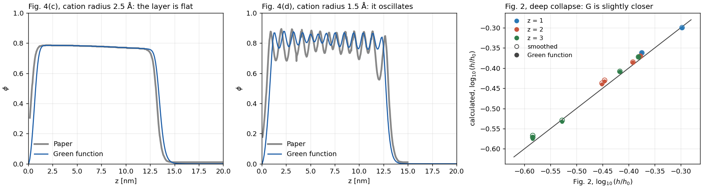
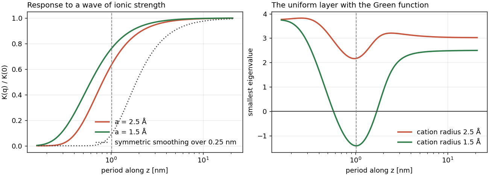
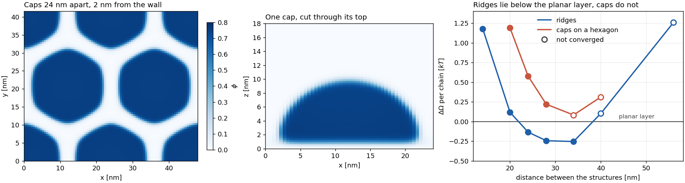
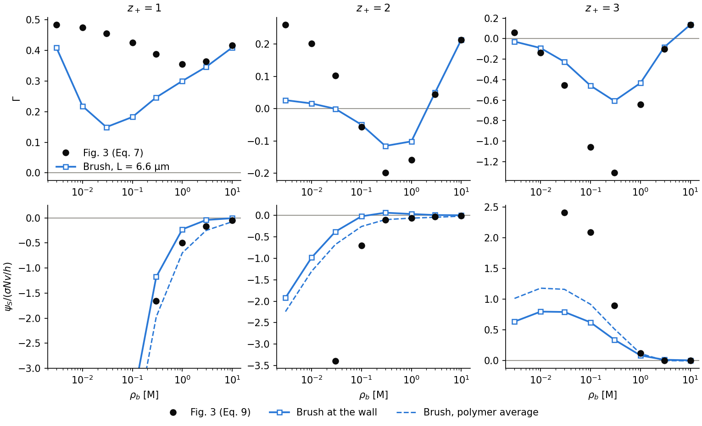

# Validation of the brush with multivalent ions

[BrushMultivalentIons1D.py](../../examples/charged/scft/multivalent_brush/BrushMultivalentIons1D.py) solves one set of equations in two solutions: the calculation behind Fig. 2 of Duan, Agrawal and Wang, Phys. Rev. Lett. 134, 048101 (2025), and the solution of the experiment shown in that figure, Yu et al., Macromolecules 49, 5609 (2016). Only the ions around the brush differ between the two, in `fig2_solution` and `experiment_solution`.

[BrushMultivalentIonsGreen1D.py](../../examples/charged/scft/multivalent_brush/BrushMultivalentIonsGreen1D.py) and [BrushMultivalentIonsLateral.py](../../examples/charged/scft/multivalent_brush/BrushMultivalentIonsLateral.py) take the same model to Fig. 4 of the paper, in [part 3](#part-3-fig-4cd-the-green-function-in-the-varying-ionic-strength) and [part 4](#part-4-fig-4ab-lateral-structure). [Part 5](#part-5-fig-3-the-charge-of-the-brush) compares Fig. 3 with the charge of the brush.

The equations, [derived with their corrections](../theory/ElectrostaticCorrelations.md), are those of the paper with $`u_P^{\rm ex}=0`$ and a local closure: a chain in a field per segment, Poisson-Boltzmann ions, and the self-energy of a Gaussian charge of radius $`a`$ at the local ionic strength. The paper also has a long-range part of the Green function, which the script leaves out, see [the table below](#what-differs-from-the-calculation-of-the-paper). The three scripts share the model in [multivalent_brush.py](../../examples/charged/scft/multivalent_brush/multivalent_brush.py). The self-energy is not part of the `SCFT` class, so that module writes the iteration itself and takes only the chain from `PropagatorSolver`. Heights are $`h=2\langle z\rangle`$.

## Part 1: the implementation against Fig. 2

The paper does not state its box length $`L`$. One value, $`L=6.6`$ µm, brings the script to all 24 readings of the figure, for $`z_+=1,2,3`$ with the same reference height, at rms 0.011 and at most 0.026. The readings carry about ±0.01. $`L`$ is fitted, so this checks the implementation and not the box.

## Part 2: the solution of the experiment

Left: the same equations at ionic strength 6 mM collapse near 40 nM in an unlimited solution, about 650 times below the experiment. In a closed cell 1.2 mm deep the fall moves to the experiment, at rms 0.049 against its four symbols. Without the self-energy the brush never collapses at any depth. Right: the calculation of Fig. 2, from an independent discrete-chain code at $`L=6.5`$ µm, against the same curve. Each point moves to the concentration with the same exchange at 6 mM, $`\rho_{\rm box}(6\ {\rm mM}/c)^3`$, with $`\rho_{\rm box}`$ and $`c`$ the densities in its own box. Three points then lie within 0.05 of the curve. The fourth, at $`\rho_b=1`$ mM, is left out: it moves to 6 mM $`{\rm Y}^{3+}`$, and a solution of ionic strength 6 mM holds at most 1 mM.

## Part 3: Fig. 4(c,d), the Green function in the varying ionic strength

[BrushMultivalentIonsGreen1D.py](../../examples/charged/scft/multivalent_brush/BrushMultivalentIonsGreen1D.py) solves the Green function of Eq. S25 at each lateral wave number, in the ionic strength of the brush, and takes the self-energy from it in place of the local form. $`I_{ex}`$ stays out. The cation has its own radius $`a_+`$. Each state has $`\sigma=0.1`$ chains/nm², $`z_+=3`$ and $`\rho_b=1`$ mM, the caption of Fig. 4. The medium of the first cell continues behind the wall, and that of the last cell past the far end of the grid, so neither end holds an image charge. A bare wall gives a density peak near 1 nm that Fig. 4 does not show.

| Fig. 4 | Paper | Script |
|---|---|---|
| (c), $`a_+=2.5`$ Å: density of the flat layer at 5 nm | 0.78 | 0.78 |
| (c): edge at half height | 13.2 nm | 13.45 nm |
| (d), $`a_+=1.5`$ Å: period of the layers | 0.89 nm | 0.87 nm |
| (d): density in the layer | 0.69–0.89 | 0.76–0.88 |

The paper's values are traced from its image with the same estimator as the script's. The oscillatory state is not unique: it settles slowly, the script stops at a residual of $`10^{-3}`$, and another start of the same equations gives 0.94 nm and 0.69–0.86, with $`dz=0.1`$ and 0.05 nm alike. Discrete chains in place of continuous ones move the smallest eigenvalue of the uniform layer from −1.42 to −1.48 at the same period of 1.02 nm, so the chain model does not set the period.

$`G`$ also moves the deep collapse of Fig. 2 slightly closer. The 11 readings where neither $`L`$ nor the length of the grid matters have rms 0.010 and at most 0.014 with $`G`$, against 0.012 and 0.018 with the smoothed form. No height changes by more than 0.005: the largest change is at $`z_+=3`$ and 1 mM, −0.571 to −0.575 against the reading −0.584. These readings carry about ±0.01. The readings that depend on $`L`$ are not compared: these runs use a grid of 120 nm, and that length alone moves $`\log_{10}(h/h_0)`$ at $`z_+=2`$ and 0.1 mM by −0.017, more than $`G`$ moves any of the 11 readings.

The smoothing of the ionic strength in parts 1 and 2 cannot give Fig. 4(d). A wave of ionic strength of period 1 nm changes $`u`$ by 63–76 % of the local value in the Green function, and by 9 % after the smoothing, which averages over $`a`$ twice. At $`a_+=1.5`$ Å the middle of the layer is then unstable at a period of 1.02 nm, and stable at 2.5 Å. Without the smoothing the local form is unstable at every period below 2 nm and selects none, which is why it needs the smoothing. [Section 11.1 of the theory](../theory/ElectrostaticCorrelations.md#111-response-of-the-self-energy-at-finite-wave-number) gives the equations.

## Part 4: Fig. 4(a,b), lateral structure

[BrushMultivalentIonsLateral.py](../../examples/charged/scft/multivalent_brush/BrushMultivalentIonsLateral.py) solves the equations of part 1 in 2D and 3D with `cn-adi2`, periodic along the wall, and with the same number of chains in every lateral column (Eq. S30). The state is $`\sigma=0.03`$ chains/nm², $`z_+=3`$, $`\rho_b=1`$ mM. The equations are the stationary point of `grand_potential()`, and the Green function is left out.

The planar layer does not break up by itself. The largest eigenvalue of its Jacobian is negative at every lateral wavelength from 5 to 80 nm, at $`\sigma=0.03`$ and at 0.1, and a weak lateral wave goes back to the flat layer. Lateral structure is a first-order competition, so the script starts from dense caps and compares grand potentials.

From that seed, $`\sigma=0.03`$ holds its structure. At a distance of 24 nm the caps give the pattern of Fig. 4(a,b) in the box of the figure, 48 × 41.6 nm: hexagons at $`\phi\approx0.75`$ with empty channels about 4 nm wide. At $`\sigma=0.1`$ the same seed goes back to the flat layer in 2D, and in 3D its contrast falls until the run stops at 0.07, which agrees with the disappearance of lateral structure in the paper.

The pattern is not the lowest state of this model, however. The caps stay above the planar layer at every distance tried, by 0.6 $`kT`$ per chain at 24 nm and by 0.08 at 34 nm, where the run stops before it converges. Ridges lie below it from about 22 nm, with a lowest value near −0.25 $`kT`$ per chain at 28–34 nm. A ridge 28 nm wide in 3D with a 10 % wave along its length loses the wave and ends at the energy of the 2D ridge, −0.244 $`kT`$ per chain, so the ridges do not break up into caps. Reference 1 reports that cylindrical bundles are unstable, without giving their direction.

## Part 5: Fig. 3, the charge of the brush

Fig. 3 of the paper plots Eq. 7 and Eq. 9, not a brush. These equations expand about the bulk and need $`\rho_b\gg\alpha\rho_P`$, which [Section 11 of the theory](../theory/ElectrostaticCorrelations.md#11-range-of-validity) places at several molar. The figure below takes the same quantities from the brush of part 1, at $`L=6.6`$ µm: $`\Gamma`$ from the charge where the density exceeds half of its largest value, and the potential at the wall and averaged over the polymer.

The two agree from 3 M, where the expansion holds: at $`z_+=3`$ and 10 M, $`\Gamma`$ reads 0.134 against 0.136. Below that the brush holds much less than the figure. The lowest $`\Gamma`$ reads −1.31 at $`z_+=3`$ and is −0.61 in the brush, and −0.199 at $`z_+=2`$ against −0.116. The conclusions of the paper keep their direction: $`\Gamma`$ changes sign at $`z_+=2`$ and 3 and not at $`z_+=1`$, and at $`z_+=3`$ the potential changes sign as well. At $`z_+=2`$ the sign of the potential depends on where it is taken: the wall reaches +0.06 at 0.3 M, and the average over the polymer stays negative.

## What differs from Fig. 2, and why

| | Fig. 2 of the paper (part 1) | Experiment (part 2) | Why it matters |
|---|---|---|---|
| Monovalent ions | Counterions C of the brush only | 3–6 mM $`{\rm Na^+}`$ from $`{\rm NaNO_3}`$ | Exchange depends on $`\rho_Y/c^3`$, with $`c`$ the monovalent density outside the brush |
| What sets $`c`$ | $`L`$: released C fill the box, so $`c\propto1/L`$ | The salt: $`c`$ is fixed and $`L`$ does not enter | In a fixed solution the height does not depend on the box. With conserved C it saturates only at much longer boxes, and at 6.6 µm the low-salt fall is not converged in $`L`$ |
| Meaning of the $`{\rm Y}^{3+}`$ axis | $`\rho_b`$ of a reservoir. C have no anion of their own, so the box sits at $`\psi_f=\ln[c/(z_+\rho_b)]>0`$ and holds $`\rho_be^{-3\psi_f}`$ | What is added to a neutral solution | At $`\rho_b=10`$ µM the box holds 0.14 nM beside $`c=1.3`$ mM, the exchange of 14 nM at 6 mM. This is the three decades between the two calculations |
| Amount of solution | Unlimited $`{\rm Y}^{3+}`$ | A finite pool in a trough | The brush needs 24 $`{\rm Y}^{3+}`$ per nm². At 1 and 10 µM a 1.2 mm layer holds less, and the bulk falls to nM |
| Reference height | Salt-free brush | Same brush in 6 mM $`{\rm NaNO_3}`$ | The zero of the two axes differs |
| Chain length | $`N=100`$ | $`N\approx730`$, from 25 mg/m² at $`\sigma\approx0.1`$ nm⁻² | Sets the length and the charge per area, not the shape: $`h\propto N`$. The script keeps $`N=100`$ and uses 73 charges per nm² for the supply |
| Height | Gibbs dividing surface, without a formula. The script uses $`2\langle z\rangle`$, the formula of a thesis from the same group (Yokokura, UC Berkeley, 2025) | Outer edge of the film, where the scattering length density reaches $`6.2\times10^{-6}`$ Å⁻² | The two differ in the two-layer range; the edge height closes no gap |

The depth of 1.2 mm is fitted, like $`L`$, and the two are different things. $`L`$ holds the released C of the calculation. The depth is the solution above the brush in the experiment, about 5.5 mL over the 3 inch wafer. Yu et al. show a Teflon trough without inlet or outlet and give no depth. Each symbol alone asks for a different depth, from 0.08 to 7 mm.

The fit is also not unique. Near 1 mm supports the self-energy as it stands; a pool near 7 mm, where the rms is 0.19, would mean that the self-energy is too strong. Measuring the depth, or running the titration at two depths, decides this.

## What differs from the calculation of the paper

| | Paper | Script | Effect |
|---|---|---|---|
| Chain | Discrete, $`N`$ beads | Continuous, `cn-adi2`, the method for brushes in this project, in all three scripts. The discrete chains of `polymerfts` are pseudo-spectral and take the same boundary at both ends. With absorbing ends, in the fields of the 24 states of Fig. 2 and of the two planar states of Fig. 4, they give densities down to −1.5 times the largest in 15 states, where the field spans 600 $`kT`$ per chain, and heights within 1 % of the continuous chains in the collapsed states | Absolute heights about 4 % larger; $`\log_{10}(h/h_0)`$ matches the readings as closely as an independent discrete-chain code. In Fig. 4(d) the period of 1 nm is close to the bond length, and discrete chains make the uniform layer 4 % less stable at the same period, see part 3 |
| Contour step | One bead per step | $`ds=0.001`$; 0.004 in the lateral script | In 6 mM salt without the self-energy the field reaches 4 $`kT`$ per segment, and $`ds=1/N`$ gives a height 14 % too large in `cn-adi2`. In the lateral states the field stays below 1 $`kT`$ per segment, and 0.004 moves the grand potential by 0.002 $`kT`$ per chain from 0.001 |
| Range of the field | Not stated | A floor 6 $`kT`$ per segment below the largest value | Double precision holds about 700 $`kT`$ over a chain, and the far region lies lower than that at low salt. At the lowest salt of Fig. 2 the density at the floor reaches $`4\times10^{-5}`$ of its largest value. A floor of 7 $`kT`$ gives the same $`h_0`$ and the same 24 heights to three decimals, and 8 $`kT`$ overflows |
| Wall, graft, grid | Not stated | Absorbing wall, Gaussian graft of width 0.5 nm. $`dz=0.25`$ nm over 200 nm in parts 1 and 2, 0.1 nm over 40 nm with the Green function, and 0.25 nm over 80 nm with two points per nm along the wall in the lateral script | Assumed |
| Box beyond the grid | Not stated | Beyond the grid the box holds only conserved ions, at the potential of the last cell, so $`L`$ is a length of this closure | For a fixed brush without the self-energy, a solved 6.6 µm box gives the same uptake to 0.1 % from 10 µM up. At the lowest readings the script takes up 7 % more at $`z_+=2`$ and 1.5 % more at $`z_+=3`$ |
| Ionic strength in $`u`$ | $`I_0`$ at the point, through $`G`$ | Averaged over a Gaussian of width $`a`$, and $`u`$ averaged in the same way in the field of each ion, which keeps the equations the stationary point of a grand potential | Stands in for $`G_l`$. An ion feels the charges around it, and without the average the local form is unstable at short periods and gets worse as the grid gets finer. The width is the ion radius, not a derived length, and it damps a period of 1 nm too strongly, see [part 3](#part-3-fig-4cd-the-green-function-in-the-varying-ionic-strength) |
| Green function | $`G=G_s+G_l`$: a local $`G_s`$ and a long-range $`G_l`$ for the varying ionic strength. Eq. 5 contains $`I_{ex}`$ | $`G_s`$ alone, at the ionic strength smoothed over $`a`$. No $`G_l`$ and no $`I_{ex}`$ | Fig. 2 is reached without them, and Fig. 4(d) is not: [part 3](#part-3-fig-4cd-the-green-function-in-the-varying-ionic-strength) keeps $`G_l`$ for a planar brush. The paper drops $`u_P^{\rm ex}`$ and does not say whether its calculations keep $`I_{ex}`$, the derivative of that term with respect to $`G`$ |

## Checks and limits

- Checked (validation run of the example): part 1 above. An independent discrete-chain code gives rms 0.012 at 6.5 µm. At ionic strength 6 mM the two codes agree to 0.010 in $`\log_{10}(h/h_6)`$.
- Checked (validation runs): a uniform layer without chain propagators. With the self-energy it collapses between 10 and 14 nM, where the height of the script halves near 40 nM, so the early collapse is not an error of the script. Without the self-energy the two agree on the height to 0.01.
- Checked (validation runs): the contour step. In 6 mM salt without the self-energy, $`ds=0.001`$ is within 0.2 % of the limit $`ds\to0`$. With the self-energy, halving it moves $`\log_{10}(h/h_6)`$ by at most 0.001 at the four symbols, through the collapse.
- Checked (validation runs): the Green function of part 3. In a uniform medium it gives the closed form to 0.03 % at $`dz=0.05`$ nm and 0.3 % at 0.1 nm for $`a=2.5`$ Å. From one start the period of Fig. 4(d) is 0.94 nm at $`dz=0.1`$ and 0.05 nm alike. $`L=5.5`$ and 6.6 µm give the same layers.
- Checked (validation runs): the lateral equations of part 4. The Poisson-Boltzmann solver gives the Debye-Hückel solution for a wave of charge to $`10^{-10}`$. At a ridge, a state with no symmetry to hide an error, the first-order change of `grand_potential()` under a random change of the field vanishes to $`3\times10^{-9}`$ and the second-order change goes as the square of the amplitude. A 2D state stays a solution on a 3D grid, and CPU and CUDA give the same energy to all printed digits. $`ds=0.004`$ moves the energy by 0.002 $`kT`$ per chain from 0.001, in 2D and at 24 nm in 3D. Two lateral points per nm against four move a ridge at 20 nm by 0.1 $`kT`$ per chain.
- Not checked: the self-energy itself against an exact result for this coupling; $`I_{ex}`$; the Green function in 2D and 3D, which is left out of part 4 and may change the order of its states; the Green function in the solution of the experiment of part 2 and at the readings of Fig. 2 that depend on $`L`$; Fig. 1 of the paper; lattices other than the hexagon, and starts other than the seeds of part 4; the box length at $`\sigma=0.03`$, taken from Fig. 2 at $`\sigma=0.1`$; the depth of the experiment's solution, which is fitted.
- Limits found: the self-energy of the paper, kept here, is not the stationary point of its free energy. It screens with point charges, and keeping the charge spread gives [Eq. N12](../theory/ElectrostaticCorrelations.md#7-uniform-state). Fig. 2 points to the form of the paper: at $`z_+=2`$ and 0.1 M, where $`L`$ does not enter, the figure reads −0.451, against −0.437 here and −0.403 with the spread. With the spread the gain of a $`{\rm Y}^{3+}`$ in the collapsed layer falls from 8.4 to 7.5 $`kT`$ and the collapse at 6 mM moves from 40 to 110 nM, still about 260 times below the experiment. The closed cell of the same depth gives rms 0.043.
- Not reproduced: the hexagon of Fig. 4(a,b) as the lowest state. The pattern forms and holds, but ridges lie below it and the planar layer lies below it at 24 nm. The distances of 34 nm and more stop at a residual near $`10^{-2}`$, where the foot of a structure creeps along the wall.
- Not reproduced: the polymer profile, compared by its shape at $`N=100`$ and not against the measured curves. Yu et al. fit a Gaussian-like collapsed film with its peak near the middle and point to pinned micelles, a lateral structure. The script gives a dense layer against the wall, and a one-dimensional calculation cannot have lateral structure; part 4 has it, in the solution of Fig. 4 and not in that of the experiment. It also places 10 µM past the onset of that layer, where the experiment still fits a parabola, so the two share a shape only at 1 µM. Agreement in the height does not reach the profile.
