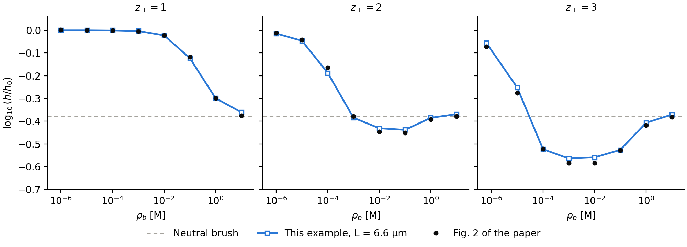
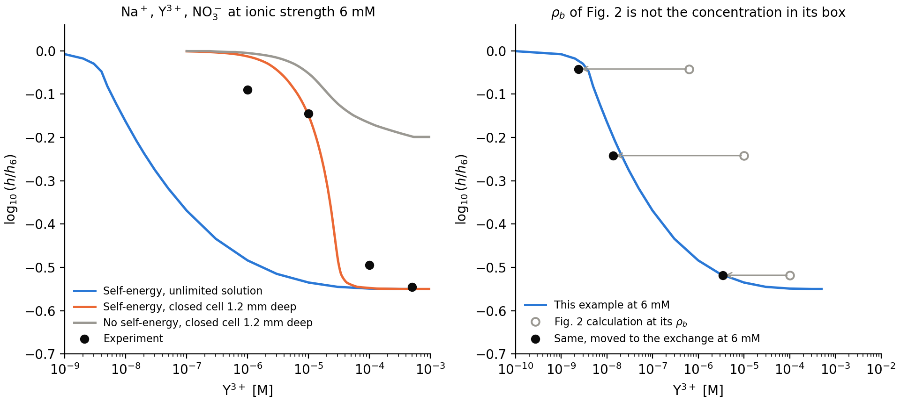

# Validation of the brush with multivalent ions

[BrushMultivalentIons.py](../../examples/charged/scft/BrushMultivalentIons.py) solves one set of equations in two solutions: the calculation behind Fig. 2 of Duan, Agrawal and Wang, Phys. Rev. Lett. 134, 048101 (2025), and the solution of the experiment shown in that figure, Yu et al., Macromolecules 49, 5609 (2016). Only the ions around the brush differ between the two, in `fig2_solution` and `experiment_solution`.

The equations are those of the paper with $`u_P^{\rm ex}=0`$ and a local closure: a chain in a field per segment, Poisson-Boltzmann ions, and the self-energy of a Gaussian charge of radius $`a`$ at the local ionic strength. The paper also has a long-range part of the Green function, which the script leaves out, see [the table below](#what-differs-from-the-calculation-of-the-paper). The self-energy is not part of the `SCFT` class, so the script writes the iteration itself and takes only the chain from `PropagatorSolver`. Heights are $`h=2\langle z\rangle`$.

## Part 1: the implementation against Fig. 2

The paper does not state its box length $`L`$. One value, $`L=6.6`$ µm, brings the script to all 24 readings of the figure, for $`z_+=1,2,3`$ with the same reference height, at rms 0.012 and at most 0.025. The readings carry about ±0.01. $`L`$ is fitted, so this checks the implementation and not the box.

## Part 2: the solution of the experiment

Left: the same equations at ionic strength 6 mM collapse near 40 nM in an unlimited solution, about 700 times below the experiment. In a closed cell 1.2 mm deep the fall moves to the experiment, at rms 0.047 against its four symbols. Without the self-energy the brush never collapses at any depth. Right: the calculation of Fig. 2, from an independent discrete-chain code at $`L=6.5`$ µm, against the same curve. Each point moves to the concentration with the same exchange at 6 mM, $`\rho_{\rm box}(6\ {\rm mM}/c)^3`$, with $`\rho_{\rm box}`$ and $`c`$ the densities in its own box. Three points then lie within 0.05 of the curve. The fourth, at $`\rho_b=1`$ mM, is left out: it moves to 6 mM $`{\rm Y}^{3+}`$, and a solution of ionic strength 6 mM holds at most 1 mM.

## What differs from Fig. 2, and why

| | Fig. 2 of the paper (part 1) | Experiment (part 2) | Why it matters |
|---|---|---|---|
| Monovalent ions | Counterions C of the brush only | 3–6 mM $`{\rm Na^+}`$ from $`{\rm NaNO_3}`$ | Exchange depends on $`\rho_Y/c^3`$, with $`c`$ the monovalent density outside the brush |
| What sets $`c`$ | $`L`$: released C fill the box, so $`c\propto1/L`$ | The salt: $`c`$ is fixed and $`L`$ does not enter | In a fixed solution the height does not depend on the box. With conserved C it saturates only at much longer boxes, and at 6.6 µm the low-salt fall is not converged in $`L`$ |
| Meaning of the $`{\rm Y}^{3+}`$ axis | $`\rho_b`$ of a reservoir. C have no anion of their own, so the box sits at $`\psi_f=\ln[c/(z_+\rho_b)]>0`$ and holds $`\rho_be^{-3\psi_f}`$ | What is added to a neutral solution | At $`\rho_b=10`$ µM the box holds 0.14 nM beside $`c=1.3`$ mM, the exchange of 14 nM at 6 mM. This is the three decades between the two calculations |
| Amount of solution | Unlimited $`{\rm Y}^{3+}`$ | A finite pool in a trough | The brush needs 24 $`{\rm Y}^{3+}`$ per nm². At 1 and 10 µM a 1.2 mm layer holds less, and the bulk falls to nM |
| Reference height | Salt-free brush | Same brush in 6 mM $`{\rm NaNO_3}`$ | The zero of the two axes differs |
| Chain length | $`N=100`$ | $`N\approx730`$, from 25 mg/m² at $`\sigma\approx0.1`$ nm⁻² | Sets the length and the charge per area, not the shape: $`h\propto N`$. The script keeps $`N=100`$ and uses 73 charges per nm² for the supply |
| Height | Gibbs dividing surface, without a formula. The script uses $`2\langle z\rangle`$, the formula of a thesis from the same group (Yokokura, UC Berkeley, 2025) | Outer edge of the film, where the scattering length density reaches $`6.2\times10^{-6}`$ Å⁻² | The two differ in the two-layer range; the edge height closes no gap |

The depth of 1.2 mm is fitted, like $`L`$, and the two are different things. $`L`$ holds the released C of the calculation. The depth is the solution above the brush in the experiment, about 5.5 mL over the 3 inch wafer. Yu et al. show a Teflon trough without inlet or outlet and give no depth. Each symbol alone asks for a different depth, from 0.08 to 7 mm.

The fit is also not unique. Near 1 mm supports the self-energy as it stands; a pool near 7 mm, where the rms is 0.20, would mean that the self-energy is too strong. Measuring the depth, or running the titration at two depths, decides this.

## What differs from the calculation of the paper

| | Paper | Script | Effect |
|---|---|---|---|
| Chain | Discrete, $`N`$ beads | Continuous, `cn-adi2`, the method for brushes in this project | Absolute heights about 4 % larger; $`\log_{10}(h/h_0)`$ matches the readings as closely as an independent discrete-chain code |
| Contour step | One bead per step | $`ds=0.001`$ | In 6 mM salt without the self-energy the field reaches 4 $`kT`$ per segment, and $`ds=1/N`$ gives a height 14 % too large in `cn-adi2` |
| Range of the field | Not stated | A floor 6 $`kT`$ per segment below the largest value | Double precision holds about 700 $`kT`$ over a chain, and the far region lies lower than that at low salt. No chain reaches the floor |
| Wall, graft, grid | Not stated | Absorbing wall, Gaussian graft of width 0.5 nm, $`dz=0.25`$ nm | Assumed |
| Box beyond the grid | Not stated | Grid of 200 nm. Beyond it the box holds only conserved ions, at the potential of the last cell, so $`L`$ is a length of this closure | For a fixed brush without the self-energy, a solved 6.6 µm box gives the same uptake to 0.1 % from 10 µM up. At the lowest readings the script takes up 7 % more at $`z_+=2`$ and 1.5 % more at $`z_+=3`$ |
| Green function | $`G=G_s+G_l`$: a local $`G_s`$ and a long-range $`G_l`$ for the varying ionic strength. Eq. 5 contains $`I_{ex}`$ | $`G_s`$ alone, at the ionic strength smoothed over $`a`$. No $`G_l`$ and no $`I_{ex}`$ | Fig. 2 is reached without them. The paper drops $`u_P^{\rm ex}`$ and does not say whether its calculations keep $`I_{ex}`$, the derivative of that term with respect to $`G`$ |

## Checks and limits

- Checked (validation run of the example): part 1 above. An independent discrete-chain code gives rms 0.012 at the same length. At ionic strength 6 mM the two codes agree to 0.012 in $`\log_{10}(h/h_6)`$.
- Checked (validation runs): a uniform layer without chain propagators. With the self-energy it collapses between 10 and 14 nM, where the script reaches half of its fall near 40 nM, so the early collapse is not an error of the script. Without the self-energy the two agree on the height to 0.01.
- Checked (validation runs): the contour step. In 6 mM salt without the self-energy, $`ds=0.001`$ is within 0.2 % of the limit $`ds\to0`$. With the self-energy, halving it moves $`\log_{10}(h/h_6)`$ by at most 0.001 at the four symbols, through the collapse.
- Not checked: the self-energy itself against an exact result for this coupling; the long-range part of the Green function and $`I_{ex}`$, which would matter most at the front of the dense layer, where the ionic strength changes fastest; the depth of the experiment's solution, which is fitted.
- Not reproduced: the polymer profile, compared by its shape at $`N=100`$ and not against the measured curves. Yu et al. fit a Gaussian-like collapsed film with its peak near the middle and point to pinned micelles, a lateral structure. The script gives a dense layer against the wall, and a one-dimensional calculation cannot have lateral structure. It also places 10 µM past the onset of that layer, where the experiment still fits a parabola, so the two share a shape only at 1 µM. Agreement in the height does not reach the profile.
