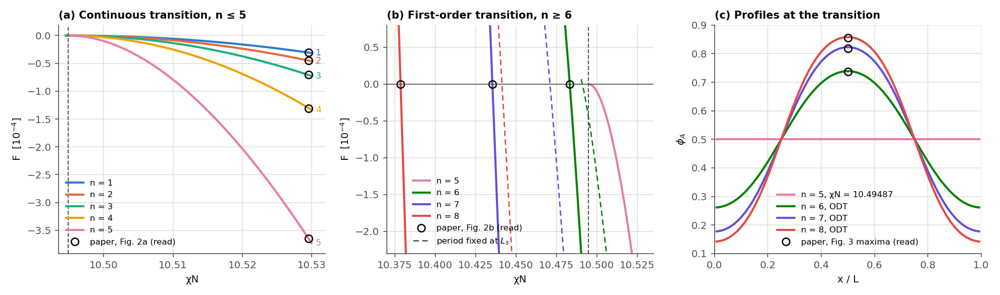
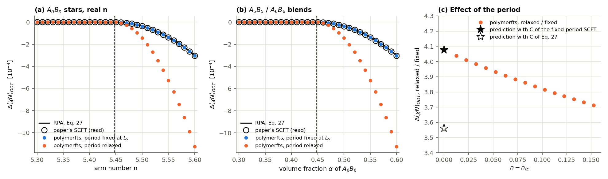

# Validation of real arm numbers

What the tests and validation runs check for block multiplicities (`"multiplicity"` in the block format of the [Parameter Reference](../references/Parameters.md), [theory](../theory/ChainPropagators.md#43-real-number-of-arms-block-multiplicity)) and for [StarNonIntegerArms1D.py](../../examples/block_copolymer/scft/StarNonIntegerArms1D.py). The labels are those of [Validation of the Examples](ExampleValidation.md).

## Checks

- Checked (`TestBlockMultiplicity`, smooth random fields with standard deviation 5, every platform, both chain models, with and without propagator aggregation and reduced memory): integer multiplicities reproduce the explicit arms, with partition functions within 10⁻¹³ and concentrations and stress within 10⁻¹², for an A₃B₂ miktoarm star, an (AB)₃ star, nested copies, a star of copies at a chain end blended with a diblock, and a pom-pom whose two copied ends share one computation block. For real multiplicities (A_nB_n with n = 5.6 and 1.5), the forward and backward partition functions agree, material is conserved within 10⁻¹², reduced memory agrees with full memory bit for bit (partition functions, concentrations and stress), the stress equals the central differences of −ln Q/α in the box lengths within 10⁻⁷ for discrete chains and within 3×10⁻⁴ for continuous chains at Δs = 0.0125 (at Δs = 0.05 the contour quadrature of the continuous stress has an error of 6×10⁻³ for real n, integer n and a diblock alike), the platforms agree within 10⁻¹⁰, the partition function in a uniform field is exact within 10⁻¹², ln Q is convex in n, and n = 5 + 10⁻⁹ joins n = 5 within 10⁻⁷.
- Checked (`TestBlockMultiplicity`, L-FTS, six Langevin steps from the same fields and noise): an A₃B₂ star given with multiplicities follows the explicit arms within 10⁻⁹ in the fields, A_nB_n at n = 5 + 10⁻⁹ (real powers) follows n = 5 within 10⁻⁶, and at n = 5.6 material is conserved within 10⁻¹².
- Checked (validation runs, figures and tables below): the SCFT results of Kim, Kang, Cho, Yong and Kim, *Macromolecules* **2026**, 59, 11903, Figs. 2, 3 and 5. The lamellar free energies of A_nB_n stars with n = 1–5 agree within 5×10⁻⁷, the order-disorder transitions (ODTs) of n = 6–8 within 10⁻⁴, inside the reading precision of 5×10⁻⁴, the density profiles at the ODT within the reading precision of 0.005, and the ODT shifts of real n = 5.46–5.60 and of A₅B₅/A₆B₆ blends within 3×10⁻⁷.
- Explained: Figs. 2 and 3 of the paper agree with SCFT in which the lamellar period relaxes, and Fig. 5 with SCFT at the period fixed at its spinodal value L_s = 1.31843 (in units of $`aN^{1/2}`$ of an arm pair). Near the tricritical arm number n_tc ≈ 5.4475, relaxing the period makes the ODT shift 4.07 times larger. The dependence of the spinodal and of n_tc on the wavenumber, both given by the paper (its Eq. 24 and SI Eq. S30), predicts the factor 4.08 (last section). Eq. 27 of the paper is the shift at a fixed period.
- Checked: the shift at a fixed period exceeds Eq. 27 by 1.6 % at n = 5.6 and by 4.9 % as n → n_tc. The paper's SCFT points show the same excess. The expansion behind Eq. 27 keeps the harmonics of the lamellar profile through the second, and the excess comes from this truncated basis.
- Not checked: ordered phases other than lamellae; discrete chains and L-FTS with real multiplicities against a published reference (the test checks their consistency only).

## Kim et al. 2026

polymerfts settings: continuous chains, `rqm4`, one lamellar period on 64 points, Δs = 1/400 of an AB arm pair (the reference chain), tolerance 10⁻¹¹. The lamellar branch is followed down from χN = 11, and the ODT is the zero of F found by bisection to 2×10⁻⁸ in χN. Beyond the end of the metastable lamellar branch the SCFT iteration does not converge, and such points count as the disordered side of the bisection. F is the free energy per arm pair relative to the disordered melt, as in the paper. The paper used 2000 points, 2000 contour steps and a residual below 10⁻¹². With 2000 points and Δs = 1/2000 the ODTs of n = 5.6 and 6, at both periods, change by less than 4×10⁻¹⁰. The paper's values are read from its figures at 300 dpi.

### Integer arm numbers (Figs. 2 and 3)



For n ≤ 5 the lamellae vanish continuously at the spinodal (χN)_s = 10.49487. The free energies at χN = 10.5296, read from Fig. 2a, agree within 5×10⁻⁷ (F = −3.06×10⁻⁵ for n = 1 to −3.65×10⁻⁴ for n = 5), and the A₅B₅ profile at χN = 10.49487 is flat (amplitude 1.6×10⁻⁸). For n ≥ 6 the transition is first order:

| n | ODT, paper (Fig. 2b) | ODT, period relaxed | ODT, period fixed at L_s | Largest φ_A at the ODT, paper (Fig. 3) | Largest φ_A, period relaxed |
|---|---|---|---|---|---|
| 6 | 10.4834 | 10.48330 | 10.49120 | 0.737 | 0.7388 |
| 7 | 10.4355 | 10.43543 | 10.47105 | 0.819 | 0.8226 |
| 8 | 10.3786 | 10.37861 | 10.44136 | 0.855 | 0.8580 |

The readings are precise to ±0.0005 in χN and ±0.005 in φ_A. The relaxed periods at the ODT are 1.3715, 1.4182 and 1.4432.

### Real arm numbers and blends (Fig. 5)



| n | Eq. 27 | Paper's SCFT (Fig. 5a) | Period fixed at L_s | Period relaxed |
|---|---|---|---|---|
| 5.46 | −2.00×10⁻⁶ | −2.00×10⁻⁶ | −2.09×10⁻⁶ | −8.43×10⁻⁶ |
| 5.50 | −3.54×10⁻⁵ | −3.65×10⁻⁵ | −3.67×10⁻⁵ | −1.443×10⁻⁴ |
| 5.55 | −1.349×10⁻⁴ | −1.386×10⁻⁴ | −1.385×10⁻⁴ | −5.285×10⁻⁴ |
| 5.60 | −2.986×10⁻⁴ | −3.036×10⁻⁴ | −3.035×10⁻⁴ | −1.1266×10⁻³ |

The paper's points are read within 3×10⁻⁷ after the offset of the reading at Δ = 0 (2.4×10⁻⁷) is removed. Below n_tc both periods give a continuous transition at (χN)_s. A blend of A₅B₅ and A₆B₆ with volume fraction α of A₆B₆ has the ODT of the star with the real arm number n = 5 + α, as the paper's Eq. 28 states: within 5×10⁻⁸ (0.02 % of the shift) at the fixed period and within 2.3×10⁻⁶ (0.2 %) with the period relaxed.

### Relaxation of the period

The paper's expansion keeps the wavenumber at the spinodal value $`\mu^* = a^2 N k^2/6 = 3.7852`$. A lamella with another wavenumber μ has its own spinodal $`(\chi N)_s(\mu)`$, the inverse of twice the bracket in the paper's Eq. 24, and its own tricritical arm number $`n_{tc}(\mu)`$ (SI Eq. S30, which gives $`n_{tc}(\mu^*) = 5.4475352`$). Near the tricritical point its transition lies at

```math
(\chi N)_{ODT}(\mu) \approx (\chi N)_s(\mu) - C\,\big[n - n_{tc}(\mu)\big]^2 .
```

With $`(\chi N)_s(\mu) \approx (\chi N)_s + a\,\delta\mu^2`$ and $`n_{tc}(\mu) \approx n_{tc} + t\,\delta\mu`$, the lowest transition over μ is

```math
\Delta(\chi N)_{ODT} = -\frac{C}{1 - C t^2/a}\,(n - n_{tc})^2,
\qquad t = 3.6703,\quad a = 0.24059 .
```

With the C of Eq. 27, 0.0128455, the factor $`1/(1 - Ct^2/a)`$ is 3.56. The fixed-period SCFT has C = 0.013478 (quadratic fit of Δ/(n − n_tc)² over n = 5.46–5.60), for which the factor is 4.076. The relaxed SCFT gives C = 0.054882, 4.072 times the fixed-period value (panel c). Since $`Ct^2/a \approx 0.75`$ is close to one, the relaxed shift magnifies differences in C: the 4.9 % between the fixed-period SCFT and Eq. 27 becomes 14 % in the factor.
